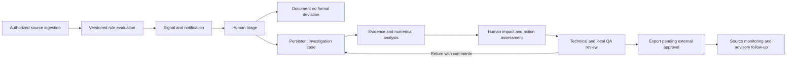

# Deviation and investigation MVP — implementation handoff

The local end-to-end workflow is implemented and remains uncommitted. A fresh, uninterrupted real-browser journey created a case from an ingested DO excursion, prepared evidence, executed the registered oxygen calculation, recorded human assessment and follow-up, went through QA return/resubmission, and exported a complete package marked **pending external approval**. No external quality approval, manufacturing action, live LLM inference or regulatory qualification is claimed.

## What is connected

Existing evidence originals/revisions, connector mappings, specifications, alerts, case identity, missions, runtime fencing, scientific model catalog, Prime execution/report interfaces and ordinary authenticated application routes are reused. The added Quality workspace provides explicit human triage, preparation, source inspection, hypotheses, impact candidates and human assessment, named evidence requests/actions, technical review, QA return/local approval and complete export. Workbench, Signals, Trends and investigation routes remain available; chat is optional.

Source ingestion emits an event → monitoring evaluates the configured versioned rule using source clocks/units → a signal and configured in-app notification persist → a person chooses whether to start/adopt local investigation work → the existing mission/runtime prepares bounded authorized evidence and runs source-supplied numerical configurations → people assess, assign follow-up and review an immutable submission → export includes all referenced originals/history and records a local export audit receipt. Source changes resume the mission, invalidate stale scientific/review bases and retain old submissions. Matching adverse post-action evidence creates a linked concern requiring human assessment; normal measurements and known pre-action late events do not.

The final acceptance repairs owner eligibility/legacy-owner diagnostics, revoked-source protection at signal/inbox/generic/dismiss entry points, sourced laboratory OOT warnings, constant-baseline statistical withholding and reassessment, mapped event-clock labels, recurrence filtering, export auditing, exact-original retry after an empty later title, duplicate source references, and useful multipoint historian charts. Charts retain every point’s source revision, separate original units and explicitly withhold a connecting trend across conflicting source versions.

## Architecture references

| Responsibility | Existing/extended implementation |
|---|---|
| Detection, event clocks, limits and source lineage | [signals.py](../../src/lifesci/signals.py), [specifications.py](../../src/lifesci/specifications.py) |
| Same-case lifecycle, impact, actions, review and export | [quality_workflow.py](../../src/lifesci/quality_workflow.py), mounted at `/v1/quality/workspaces` |
| Authorized source assembly and chronology | [quality_evidence.py](../../src/lifesci/quality_evidence.py) |
| Persistent background work | [missions.py](../../src/lifesci/missions.py), [runtime.py](../../src/lifesci/runtime.py) |
| Source-backed science and ordinary investigation snapshots | [case_science.py](../../src/lifesci/case_science.py), [investigations.py](../../src/lifesci/investigations.py), [frozen scientific tools](../../src/prime_runtime/science.py) |
| Shared Engineer/MSAT/QA workspace | [QualityWorkspace.tsx](../../../frontend/components/quality/QualityWorkspace.tsx), `/quality/` |

## Records and execution

No SQL schema migration or replacement system of record was introduced. Existing JSON `case.workflow` holds local state, discovery/current source refs, preparation, science, hypotheses, assessment/impact, requests, actions, review snapshots/decisions and activity; existing `quality_intent` records provide revision-bound retry receipts. `physical_analysis_result` records hold actual numerical outputs and source lineage. The final changes add internal `quality_export` records with actor/time, case revision, exact manifest/package hash, format and pending external status; `lab_oot` is distinct from OOS. The human “no formal deviation” decision now has an explicit `assessed_no_formal_deviation` outcome and `not_requested` external status, with deliberate assignment required before technical review.

Engineering/MSAT use actual current permissions to inspect risks, prepare and assess. Only eligible owners can finish technical review; assigned QA performs local review/return. Backend checks remain authoritative after revocation. Existing ineligible legacy owners are named explicitly instead of silently reassigned. Agents can perform bounded advisory preparation/science under the owner’s current authority; they cannot make human QA or operational decisions.

The registered `fermentation.pressure_cost` solver ran with explicit source-supplied absolute inputs: predicted OTR **100 mg/(L·h)** versus a supplied observation **95**, with OUR **40** and positive margin **60**. This is a conditional oxygen-transfer calculation, **not** prediction of the declining DO trajectory or evidence that transfer limitation caused it. The real investigation citation route was exercised against a persisted `LocalExecutor` report generated by a disclosed deterministic registered-model runner; no Prime model reasoning was invoked.

## Acceptance evidence

All originals are explicitly synthetic. API scenarios use actual mounted routes, isolated stores, ingestion, mission/runtime and registered model services; browser requests were never fulfilled with fabricated responses.

| Scenario | Outcome and proof mode |
|---|---|
| A — excursion to handoff | Actual original rows → duration/spec signal and responsible-person inbox → human triage → runtime preparation/model execution → impact candidates/assessment/action → technical/QA review → complete pending export. API/runtime plus fresh browser case `DEV-C5QCEG18`. |
| B — laboratory OOS | Original sourced OOS preserved; explicit preliminary laboratory assessment expands to manufacturing evidence and reaches local QA review. Mounted API/runtime. |
| C — deterioration risk | Distinct yield summaries against explicit baseline produce an advisory warning. Missing scientific configuration is honestly withheld; engineer records no formal deviation with a separate local outcome. No automatic formal deviation. Mounted API/runtime. |
| D — missing calibration | Named required request blocks approval; an actual later synthetic certificate enters ingestion, resumes the mission and resolves the request with its valid ref. Mounted API/runtime. |
| E — QA return/correction | Incomplete submission rejected, QA returns with comments, actual corrected supporting source is ingested, new assessment/submission passes. Old submission, decision and original revision remain in export. API/runtime; browser also proves the return/resubmit cycle. |
| F — effectiveness follow-up | Completed action has evidence; later adverse event creates a linked human-assessment concern. Normal data and known pre-action late arrivals do not; missing clocks stay uncertain. No autonomous effectiveness conclusion. Mounted API/runtime. |

A same-ID source correction separately proves safe scientific refresh after QA return: old signal observations and revision-1 review/model basis remain preserved; new science uses revision 2. The final chart check also preserves revisions 1/2/3 and distinct mg/L/ug/L axes.

## Verification and measurements

- Final whole-change review repair wave addressed **I1–I3 and M1–M5**: native sources now reach catalog/registered models/ordinary snapshots; saved impact remains visible through QA; advisory recurrence concerns expose exact sources and uncertainty; follow-up lookup recovery, submission actor/time, legacy adoption inspection, reopened external status and scientific catalog refresh are corrected. Backend **86 passed in 6.78s**, additional native authority **1 passed in 2.26s**, existing snapshot/privacy **4 passed in 1.57s** (overlapping). Fresh final browser **20 checks in 15.806s**, legacy adoption **19 checks in 5.919s**, zero page exceptions/external requests; final build passed TypeScript and **61 pages**. [Fix report](reviews/final-fixes-report.md), [UI proof](../quality-browser-20261115/final-review-ui-green/result.json), [legacy proof](../quality-browser-20261115/final-review-adoption-green/result.json), [build log](logs/final-fixes-frontend-build.log).
- Review fix I1: upstream OOT now preserves its warning **and** continues independent configured numerical evaluation. The exact 90% purity versus 98–100% local-spec regression and affected suites passed **97 tests in 8.87s**. [RED](logs/task5-fix1-red.log), [GREEN](logs/task5-fix1-green.log). This backend-only follow-up did not repeat the full suite/build/browser.
- Final science/monitoring/acceptance regression: **82 passed in 8.01s**, including the 25 acceptance tests. Scenario artifact run: **24 passed in 34.34s** before the additional constant-baseline reassessment regression. These overlap; do not add them.
- Fresh browser: **25 checks, 26.731s**; real persisted citation **7 checks, 4.457s**; multipoint source selection **4 checks, 5.509s**; correction/unit chart **6 checks, 4.121s**; committed-response-loss retry **9 checks**. These are scripted synthetic timings, not engineer resolution time.
- Final production frontend build passed, including TypeScript validation and **61 static pages**, with telemetry disabled and isolated output.
- Full backend attempt: **1865 passed, 28 failed, 36 skipped, 41 errors, 48 passing subtests in 649.23s**. It was not clean. All 41 errors and 9 failures were sandbox socket/bind restrictions; 19 failures require unavailable CHO pilot/aligned trajectory artifacts or the absent Lyo upstream checkout. The scoped OS-enabled relevant rerun passed **1187 tests and 48 subtests in 362.26s**, exit 0, clearing the socket-dependent failures. The 19 missing-artifact failures remain limitations of the full attempt. These runs overlap. [Full log](logs/task5-broad-regression.log), [relevant rerun](logs/task5-relevant-regression.log).
- Instrumented source ingestion: 48 measured calls, median 0.002255s; evidence collection: 48 calls, median 0.001982s; frozen retrieval: 4 calls, median 0.002494s; deterministic model tool: 3 calls, median 0.010459s. Nested spans overlap and cover the measured test thread only. Inference duration is **not run / null**, not zero. [Machine-readable metrics](metrics.json), [scenario originals, packages and clocks](scenarios-final).

## Limits and remaining concerns

No live MES/LIMS/eQMS vendor connection, external handoff receipt, production worker deployment, live model accuracy, calibrated root-cause accuracy or GMP qualification was demonstrated. Existing systems remain authoritative. Missing legacy external signal references cannot be independently authorized as local records; every known local lineage is checked against current authority. Local request/action evidence proves source-backed tracking, not that the application executed a plant action.

The final review’s three Important and five Minor findings are addressed in the bounded fix wave, with focused RED/GREEN proof above. The scoped re-review closed all eight findings with no new issues. Both evaluation servers were stopped, and ports 8158 and 5198 were verified closed. [Final review verification](reviews/final-fixes-review.md). The earlier full-suite missing-artifact failures remain explicitly reported. Original benchmark artifacts, reviewed snapshots and failed attempts are retained; no commit, push or deployment occurred.

## Implementation decisions

The implementation ledger records five explicit rulings, retained here with their costs if wrong:

- The user's immediate implementation request authorized execution after inspection, without another design gate. Misreading that scope would require rework; the approved spec remains the boundary.
- Work stayed in the existing uncommitted feature checkout, preserving the user's prior changes and benchmark paths. This provides less isolation and requires careful manual rollback by change, rather than resetting the branch.
- Reviews use working diffs plus new-file contents against recorded baselines. Incorrect baselines could hide edits, so the scratch copies, reports and review records remain available; no committed history archive exists to replace them.
- The minimal assignee directory exposes only display/actor/eligible-role information within an authorized site, with authority rechecked on mutation. Incorrect filtering would risk privacy or eligibility errors; the current authorization regressions cover this boundary.
- Environment approval calls became sequential after batched requests stalled. The cost is extra elapsed time, accepted to keep approvals and process ownership observable.
