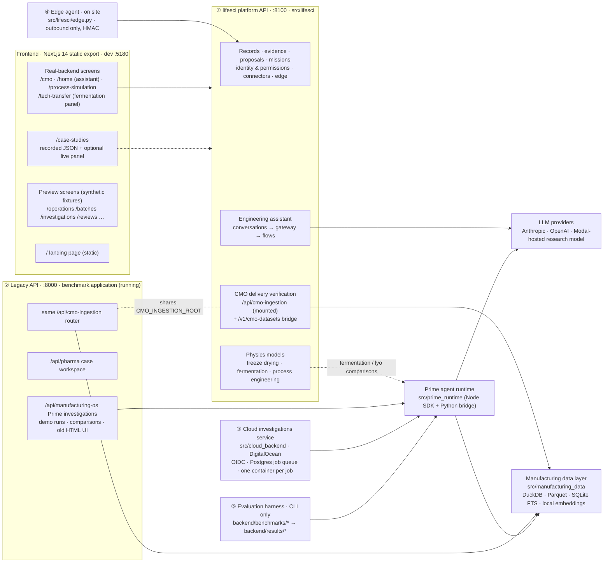
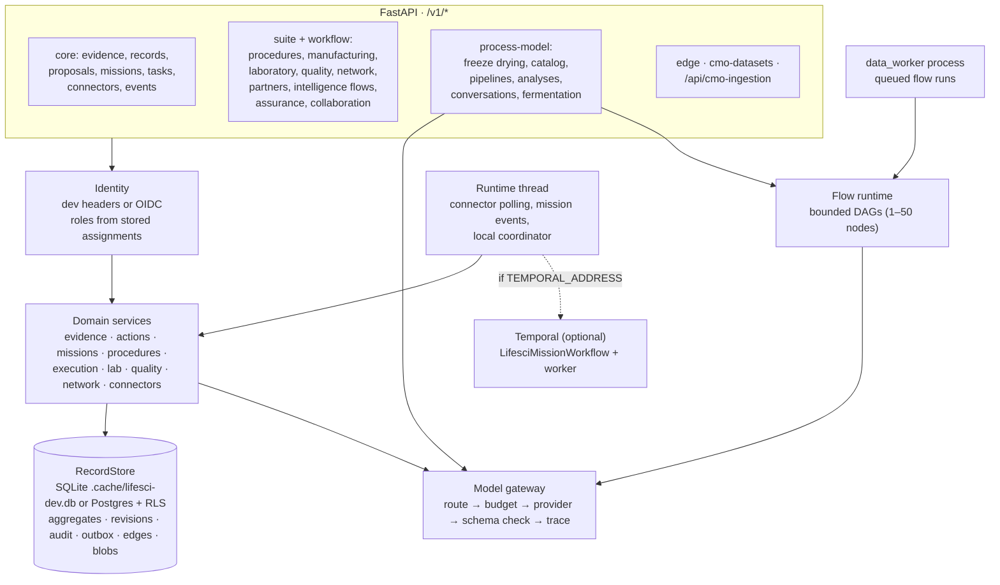

# Current architecture and handoff — 29 October 2026

This document describes the whole system **as it is in the working tree now**, including uncommitted changes. It covers every running and deployable part, not only CMO delivery verification. §13a maps the duplication, layering problems and size that make the repository feel bloated. Read [`Main_Culture_andETHOS.md`](../../Main_Culture_andETHOS.md) and [`AGENTS.md`](../../AGENTS.md) first. They govern design and product decisions: the four pillars (Easy to Start, Trust, Act, Adopt), provenance, permissions, human authorization, and no claims of validated results without evidence.

**About 300 files are uncommitted**, including every real-backend frontend screen and its API clients. Run `git status` before changing anything. Treat unfamiliar changes as user work.

---

## 1. Status at a glance

| Question | Answer |
|---|---|
| What is the product? | An AI operating system for pharmaceutical manufacturing. It reads existing systems without writing to them, investigates with labelled evidence, forecasts with physics-based models, and turns findings into proposals that named people sign. |
| What works end to end on real data? | **CMO delivery verification**: contract-manufacturer spreadsheets, LIMS exports and certificates become one verified dataset linked to its sources. Verified deliveries can be handed to the assistant as evidence. |
| What else is real? | Freeze-drying and fermentation physics models, the process-engineering pipeline, the platform's record, evidence, proposal, mission and permission services, and the Prime investigation agent (used for research and benchmarks). |
| What is preview only? | Most workspace screens (operations, batches, investigations, optimization, reviews, quality, lab, planning…) use synthetic fixtures and make no API calls. |
| Which backend does the app use? | The **lifesci platform API on :8100**. The legacy server on :8000 is still running, but the current frontend does not call its own routes. |
| Is any experiment running? | **No.** The final physics A/B run finished at 20:08 on 28 Oct with 1,151 of 1,152 sessions scored (§8.2). Earlier progress messages such as "844 sessions complete" were snapshots of that run; it is now finished. |
| Are live LLM answers working locally? | No model is configured or qualified. Without a model, the assistant saves the message and reports "unavailable". |

---

## 2. System map

Five deployable systems share one Python codebase (`backend/`) and one frontend (`frontend/`).



| # | System | Entry point | Used by the current app? | Status |
|---|---|---|---|---|
| ① | lifesci platform API | `python -m src.lifesci serve --port 8100` | **Yes, the main backend** | Active |
| ② | Legacy API | `python -m benchmark serve --port 8000` (running now, PID 78555) | Only through the shared CMO router, and only if `NEXT_PUBLIC_CMO_API_URL` points at it | Legacy but still maintained |
| ③ | Cloud investigations service | `src.cloud_backend.entrypoint api` / `dispatcher` | No | Separate deployment target; lifesci reuses only its OIDC verifier |
| ④ | Edge agent | `python -m src.lifesci.edge --config …` | Indirectly (posts to ①) | Real; systemd unit provided |
| ⑤ | Evaluation harness | `python -m benchmarks.<module>` | No; results feed reports and the landing page | Active |

---

## 3. lifesci platform API (`backend/src/lifesci/`)

### 3.1 How it starts

- **`__main__.py` subcommands:** `serve`, `seed-demo`, `seed-suite`, `db-migrate`, `worker` (Temporal). Settings load from `backend/.env.local` (or `LIFESCI_ENV_FILE`); real environment variables win.
- **`container.py` → `Platform`:** one `RecordStore`, then every service. `extend_api()` adds the suite, workflow, freeze-drying, process-engineering and fermentation routes.
- **`api.py` → `create_app`:** core routes, then `extend_api`, `install_edge_api`, `install_cmo_api`. Error mapping: permission → 403, conflict/lease → 409, not found → 404, bad input → 400. POSTs accept an `Idempotency-Key`.

### 3.2 Internal structure



### 3.3 Core services

| Concern | Implementation |
|---|---|
| **Identity** | Dev mode: `X-Tenant-Id`, `X-Actor-Id` headers (the frontend sends `demo-northfield` / `priya`). Production: OIDC bearer tokens via `src/cloud_backend/auth.Verifier`. Roles always come from stored assignments, never headers. Agents can never approve, sign, release, execute, close or authorize writes. Derived records are readable only while every input is still readable and current. |
| **Record store** | `store.py`. Each domain object is a versioned JSON aggregate with optimistic concurrency. One transaction writes the aggregate, revision, audit row, indexes and outbox event. Postgres adds row-level tenant isolation and append-only triggers on audit and revisions. Original bytes are stored as blobs in the database; lifesci uses no object storage. |
| **Evidence** | `evidence.py`. Immutable evidence with original bytes, normalized values, derived records with lineage edges, and a stale cascade when inputs change. |
| **Actions** | `actions.py`. Proposal → approval bound to a content hash → fenced action intent → dispatch/reconcile → outcome. A risk policy maps each operation to required roles. |
| **Missions** | `missions.py`, `runtime.py`, `orchestration/`. Durable obligations, decisions and corrections. Runs in-process by default, or on Temporal when `TEMPORAL_ADDRESS` is set (backlog replay if Temporal is unreachable). |
| **Model gateway** | `gateway/`. Tiers C0 (deterministic code) to M3. Picks the cheapest qualified model; with none qualified it refuses unless `LIFESCI_ALLOW_UNQUALIFIED_ROUTES=1`, in which case results are marked unqualified and need human review. Budgets, retries, schema validation and rejection of citations to unsupplied sources. `LIFESCI_LLM_PROVIDER` / `LIFESCI_LLM_MODEL` bind engineering planner/interpreter models. **Nothing in production code qualifies a model.** |
| **Flows** | `flows.py`, `data_worker.py`. Bounded, leased, resumable DAGs of gateway tasks or registered operators. |
| **Connectors and edge** | `connectors.py`, `integrations.py`, `edge.py`. Site-scoped MES/LIMS/QMS/ERP/historian/ELN/CMMS/WMS over REST, file, webhook, MQTT, OPC UA. Credentials are environment-variable references. Edge gateways push signed records (HMAC, ±300 s, ≤1 MB). Depends on legacy `benchmark.integration` classes. |
| **Domain modules** | Procedures (typed steps, units, safe expressions), execution (batches, steps, signatures, exceptions; release only creates a proposal), lab, quality cases and QA packages, network transfers and partner grants, assurance (requirements, JUnit test runs, trace), remote sessions (LiveKit, optional). |

**Library-only code (tested, not wired to routes):** collaboration triggers and notification channels, quality claims/forms/reuse, network lifecycle and scheduling, ERP reconcile and subscriptions, `science.ProfileMonitor`, `WorkQueue`, assurance export/restore/retention/legal holds.

### 3.4 Physics models and the assistant

| Module | What it does | Routes | Status |
|---|---|---|---|
| `lyophilization/` | Primary-drying moving-front model (reconstruction of Vanbillemont et al. 2025), provenance-tagged inputs, recommendations as proposals | `/v1/process-model/contexts`, `/runs*` | Real; labelled an unqualified scientific demonstration |
| `process_engineering/` | Model catalog, bounded solver pipelines, analysis review and interpretation | `/v1/process-model/catalog`, `/pipelines*`, `/analyses*` | Real; LLM steps need a model route |
| `process_engineering/conversation.py` | **Engineering assistant.** Chat intent → gateway decision → flow of 8 registered operators. Turns run as FastAPI background tasks. Accepts up to 5 verified CMO dataset ids as cited evidence. | `/v1/process-model/conversations*`, `/conversation-sources`, `/llm-connection` | Real; answer quality not yet tested with a live model |
| `fermentation/` | Literature-grounded aerobic transfer cases (Sulfolobus kLa scale-up, Pichia pressure vs oxygen cost). Deterministic physics; optional Prime assessment on a Modal-hosted research model | `/v1/process-model/fermentation/*` | Physics real; agent path research only |
| `science.py` | Control charts, cohorts, yield, OEE, 4PL, qPCR as deterministic C0 tasks | via `/v1/tasks` | Real |

### 3.5 CMO delivery verification inside the platform

- `cmo_datasets.py` mounts the CMO router (`src/manufacturing_data/cmo/api.py`) at **`/api/cmo-ingestion/*`**. It is skipped with a warning if the `manufacturing-data` extras are missing.
- **Separate auth (open issue):** these routes use `X-CMO-Token` (`CMO_API_TOKEN`) and `X-Tenant-ID`, not platform identity.
- **Bridge to evidence:**
  - `POST /v1/cmo-datasets {run_id, site_id}` publishes a verified run as evidence id `cmo-verified-delivery:<run_id>`, classification `verified_cmo_dataset`. It returns 409 if the run is unverified, fails a guarantee check or has been superseded. Republishing an unchanged delivery is idempotent.
  - `GET /v1/cmo-datasets` lists them; `GET /v1/cmo-datasets/{evidence_id}` returns a bounded summary.
- The assistant receives that bounded summary plus the evidence reference. Its prompt says to cite evidence id, batch, time and source location; that verification is not process control or batch release; and that physics models do not yet use these datasets.

---

## 4. CMO delivery verification (`backend/src/manufacturing_data/cmo/`)

- **Pipeline (`pipeline.py`, `IngestionService`):** ingest → classify → parse → map → validate → review → store/export. Configurations: `auto`, `D` (confirmed templates, local, no model calls), `preview`, `decisions` and `clairic_decisions` (hosted extraction), and legacy `A`–`C`.
- **Hosted extraction (`providers.py`), off unless approved:** Cloudflare Workers AI (Clairic) and an OpenAI decisions endpoint. Guarded by an outbound allow-list and `CMO_HOSTED_INFERENCE_APPROVED` (or synthetic data only).
- **Storage:** `persistence.py` uses SQLite at `<CMO_INGESTION_ROOT>/cmo.sqlite`, or Postgres (Supabase) when `CMO_DATABASE_URL` is set. Events are hash-chained and append-only. `evidence.py` keeps originals locally and optionally in a private Supabase Storage bucket, content-addressed and re-hashed on read.
- **Quality:** `quality.py` tracks "zero silent errors" (no wrong value or missing value passes without a flag).
- **`/api/pharma` case workspace (`cases.py`, `case_api.py`):** mounted only by the legacy server; always local SQLite even when ingestion uses Postgres; no frontend client.

---

## 5. Shared libraries

| Library | Purpose | Notes |
|---|---|---|
| `src/manufacturing_data/` (non-CMO) | Ingests packages into `metadata.sqlite` + Parquet + content-addressed originals. Document parsing with Docling, Tesseract, pypdf, python-docx. Search with SQLite FTS5 and local FastEmbed embeddings. 13 tools (`inspect_data`, `query_data`, `search_evidence`, `verify_evidence`, `align_series`, …). `query_data` runs DuckDB with external access off. | No hosted LLM calls. Used by Prime, workflows, cloud, CMO, fermentation. |
| `src/prime_runtime/` + `prime_skills/manufacturing_os/` | **Prime investigation agent.** Python spawns the Node Prime SDK (`sdk_runner.mjs`) with one `ipython` tool and the manufacturing skill. A per-run localhost bridge (`bridge.py`, bearer token) exposes evidence tools, report validation and budgets. Needs Node and the Prime bundle (`PRIME_AGENT_BUNDLE_ROOT`, default `../prime-agent-bio`). Optional Modal provider. | Used by legacy investigations, cloud jobs, fermentation/freeze-drying comparisons and benchmarks. |
| `src/workflows/` | Post-investigation workflow (triage, tasks, evidence requests, review, close) in SQLite; deterministic report and citation checks. | Never executes manufacturing actions. |
| `src/state/` | Blackboard, causal hypothesis graph, decision graph. | Used with Prime. |
| `src/data/`, `src/evaluation/` | Frozen Fresenius tables and a future-leakage audit. | Benchmark utilities; only `parse_time` is on a live path. |

---

## 6. Legacy API (`backend/benchmark/`)

- **`benchmark/application/` on :8000 (running).** Demo mode keeps everything in memory with seeded cases. Production mode expects Neo4j, MongoDB, Postgres, S3/MinIO and optional Qdrant (`docker-compose.knowledge.yml`). It serves:
  - the shared CMO router and `/api/pharma`
  - Prime investigations (`/api/manufacturing-os/*`), source-review packets, investigation workflow
  - demo runs that start real Prime comparisons (`runs/demo-agent/`)
  - case comparisons, incident demo, publication pages and an old HTML UI at `/`
- Its connector monitor keeps rewriting `backend/.prime/connectors.json` (one broken test connector). That is why the file keeps showing as modified.
- **Other `benchmark/` packages:** `integration/` is legacy code that lifesci still imports. `knowledge/`, `case_comparison/`, `incident_demo/`, `pharma_simulation/`, the 30-day campaign simulator (`simulation.py`, `factory/`, `controllers/`, `systems/`) and the top-level scripts (`generate_dataset.py`, `run_validation.py`, …) are historical benchmark tooling with no LLM use. `quality_triage/` is empty.

---

## 7. Frontend (`frontend/`)

Next.js 14 App Router, Tailwind, three.js, static export to `dist/` (`NEXT_DIST_DIR` overrides).

| Area | Routes | Data source |
|---|---|---|
| Shell | `AppShell`, `TopHeader`, `PrimaryNav` (in `Sidebar.tsx`) | Four nav items: **Deliveries** `/cmo`, **Assistant** `/home`, **Simulation** `/process-simulation`, **Case studies** `/case-studies`. Other screens are reachable by URL or ⌘K. |
| Deliveries | `/cmo` (`components/cmo/*`) | `lib/cmo-api.ts` → `/api/cmo-ingestion/*`; **Ask the assistant** → `POST /v1/cmo-datasets` |
| Assistant | `/home` (full-page `Companion` + `EngineeringChat`); floating companion elsewhere | `lib/process-api.ts` → `/v1/process-model/conversations*`, `/v1/cmo-datasets` |
| Simulation | `/process-simulation` (and duplicate `/advanced`) | `/v1/process-model/runs*`, `/contexts`, `/catalog`, `/pipelines*`, `/analyses*` (own copy of the base URL) |
| Tech transfer | `/tech-transfer` | Synthetic portfolio, plus the live `FermentationTransfer` panel |
| Case studies | `/case-studies` | Recorded JSON in `public/case-study-results/` (gitignored, so a clean build lacks it), plus the optional live fermentation panel |
| Landing | `/` | Static copy; every figure must come from a recorded result |
| Preview | `/operations`, `/batches/*`, `/timeline`, `/investigations/*`, `/optimization/*`, `/reviews/*`, `/quality/*`, `/laboratory/*`, `/planning`, `/agents`, `/runs/*`, `/knowledge`, `/sources`, `/workspaces`, `/onboarding/*`, `/operator/*`, `/settings/governance`, `/sign-in` … | Synthetic fixtures (`fixtures/biomanufacturingData.ts`, campaign CMP-26-10, fictional Aster Biologics). Several lack the "Synthetic demo data" label. |
| Agent interaction layer (commit 6d8e2be) | Composer, dock, canvas slots, review gate | **Fully simulated in the browser** (timer-driven state machine). No agent API behind it. |

API base URLs: `NEXT_PUBLIC_LIFESCI_API_URL` (default `http://127.0.0.1:8100`); `NEXT_PUBLIC_CMO_API_URL` overrides the CMO base only.

Dead or orphaned code: `AgentBottomRunStrip.tsx`, `RunStrip.tsx`, `WorkbenchPreview.tsx`, `NAV`/`SETTINGS_NAV` in `lib/routes.ts`, `scripts/export_data.py` (writes to a missing `src/data/`), and a stray untracked build under `frontend/private/var/…`. `frontend/content_rules.md` appears to come from a different (video) project, although earlier notes treated it as the landing-page copy guide.

---

## 8. Evaluation harness and recorded results

### 8.1 Harness map (`backend/benchmarks/`)

| Module | Purpose | Output | Status |
|---|---|---|---|
| `external_simulators/` | AI alone vs AI + physics tool on PenSimPy and SMPL simulators | `results/external-simulators/<run>/`, `docs/case_studies/<run>/` | **Active; final run complete** |
| `cmo_ingestion/` | CMO fixtures, real-CHO demo packages, evaluator | `results/cmo_ingestion/` (latest `cho-2026-10-28/`) | Active |
| `physics_value/` | Synthetic oxygen-supply / freeze-drying pilot | `results/physics-value/` (**missing locally**) | Pilot |
| `common/` | Shared runner, frozen cases, adapters, input store, provenance checks, reports | `results/evaluation/<uuid>/` | Heavily modified, uncommitted |
| `autonomous/`, `cho/`, `fresenius/`, `baselines/`, `data_layer_evaluate.py` | Earlier investigation benchmarks | `results/cho`, `results/fresenius`, `docs/case_studies/results/` | Historical |

`/benchmarks`, `/results` and `/runs` at the repo root are symlinks to the `backend/` copies.

### 8.2 Physics A/B — final run (current source of truth)

- **Run:** `backend/results/external-simulators/model-repair-continuous-20261028/`. **Report:** [`docs/case_studies/model-repair-continuous-20261028/report.md`](../case_studies/model-repair-continuous-20261028/report.md).
- **Design:** 48 fresh cases per simulator, seeds **9001–9048**, three tasks (forecast, operating decision, recipe adaptation), two repeats, two arms → 1,152 sessions. Model `modal/zai-org/GLM-5.3`; each session capped at 120 s, 8 model calls, 10 tool calls and 8,192 output tokens. Protocol and fits frozen before inference ([protocol](../research/model-repair-protocol-20261028.md), [source admission](../research/model-repair-source-admission-20261028.md), [continuous oxygen](../research/model-repair-continuous-oxygen-20261028.md)).
- **Execution:** 1,151 / 1,152 scored. **One failure:** PenSim forecast, arm A, repeat 2, "Request was aborted" after the output-token cap. It stays in the primary results; the recovery rule covers only connection errors, so no recovery pass ran. 11,238 input, arithmetic and model-hash checks passed. Arm B used the tool in 576 sessions (1,608 calls, 0 tool errors).
- **Results** (95% case-bootstrap intervals):

| Simulator | Task | AI alone | AI + physics | Effect | Threshold met? |
|---|---|---:|---:|---|---|
| PenSimPy | forecast error | 3.86% | 3.23% | 16.5% lower [−0.3, 30.4] | No (needs >20%) |
| PenSimPy | operating decision | 91.2 | 99.5 | +8.3 points [2.2, 16.2] | No (needs >5) |
| PenSimPy | recipe adaptation | 91.2 | 98.5 | +7.3 points [2.3, 13.8] | No |
| SMPL | forecast error | 3.14% | 0.50% | 84.0% lower [74.0, 92.5] | Yes |
| SMPL | operating decision | 97.7 | 98.3 | +0.5 points [−0.1, 1.2] | No |
| SMPL | recipe adaptation | 82.6 | 99.7 | +17.1 points [6.9, 27.7] | Yes |

- **Overall:** the pre-set criterion (all six contrasts) is **not met**. SMPL forecast agreement is expected, because the tool and simulator share equations and initial state; this is not external validation. Full 230 h PenSim still fails (negative viscosity) and stays unqualified. Real-CHO findings from earlier studies are unchanged (glucose error was worse with the simple model: 0.60 → 0.72 g/L).

**Superseded physics runs (kept, do not cite as current):** `model-repair-20261028/` (seeds 8001–8048, stopped after an oxygen-floor admission error), `model-repair-admitted-20261028/` (stopped at generation), `challenges-20261028/` / `docs/case_studies/operating-challenges-20261028/` (pre-repair models), `improvements-20261027/`, `physics-vs-no-physics-20261027/`, `external-simulators-20261027/`. `fit-identifiability-dev-20261028/` is a development diagnostic.

### 8.3 CMO delivery verification results

`backend/results/cmo_ingestion/cho-2026-10-28/report.json`, configuration D, local, no model calls:

| Condition | Recall | Value accuracy | Verified automatically | Silent errors | Silent omissions |
|---|---:|---:|---:|---:|---:|
| Unseen form | 100% | 100% | 0% | 0 | 0 |
| Unseen + one confirmation | 100% | 100% | 100% | 0 | 0 |
| Returning (October, 1,843 values) | 100% | 100% | 100% | 0 | 0 |
| Changed (November, 2,113 values) | 100% | 100% | 0.47% | 0 | 0 |
| Changed + one confirmation | 100% | 100% | 99.67% (2,099/2,106) | 0 | 0 |

Browser check: September delivery verified in 12 clicks. Human time saved is **not measured**. Demo data: Zenodo record 20829178 (CC BY 4.0), 24 CHO runs, fictional CMO "Northfield Biologics".

---

## 9. Storage and external services

| Store / service | Used by | Required? |
|---|---|---|
| SQLite `.cache/lifesci-dev.db` or Postgres (`LIFESCI_DATABASE_URL`) | lifesci records | One of them |
| `CMO_INGESTION_ROOT` (SQLite + originals) or Supabase Postgres + Storage | CMO verification (shared by :8000 and :8100) | One of them |
| `metadata.sqlite` + Parquet stores | Data layer, Prime investigations | For investigations |
| Temporal | lifesci missions | Optional (in-process by default) |
| Anthropic / OpenAI | Gateway, assistant | Optional; nothing works without a configured route |
| Modal-hosted research model | Prime research runs, physics A/B | Research only |
| Cloudflare Workers AI, OpenAI decisions | CMO hosted extraction | Off unless approved |
| LiveKit | Remote sessions | Optional |
| Neo4j, MongoDB, MinIO, Qdrant, Kafka | Legacy server production mode | Legacy only |
| DigitalOcean droplet + Spaces, Caddy, Squid | Cloud investigations service | That deployment only |
| DagsHub artifact store | Large benchmark assets, parser models | Benchmarks |

---

## 10. Deployments (`backend/deploy/`)

| Directory | Deploys | Services |
|---|---|---|
| `lifesci/` | **The platform** | Postgres 16, migrate, Temporal dev server, API :8100, Temporal worker, data worker, optional LiveKit. Read-only containers, `cap_drop: ALL`. Includes CMO (`CMO_INGESTION_ROOT=/data/cmo`, `CMO_API_TOKEN`). Edge agent systemd unit and example config. |
| `cmo-ingestion/` | Legacy standalone CMO app | Legacy API :8000 + nginx serving the frontend build on :8080 |
| `supabase/` (untracked) | Hosted CMO system of record | SQL migration and setup notes for Supabase Postgres + Storage |
| `cloud/` | Cloud investigations service | Terraform (DigitalOcean), Caddy, API, Docker dispatcher, Postgres 17, Squid egress proxy, backups |
| `backend/Dockerfile`, `docker-compose.knowledge.yml` | Legacy server in production mode | Neo4j, MongoDB, Postgres, MinIO, Qdrant |

---

## 11. Running locally

```sh
# Platform API (deliveries, assistant, simulation); seeds demo identities
cd backend && ../.venv/bin/python -m src.lifesci serve --port 8100 --seed-demo

# Frontend
cd frontend && npm run dev            # http://127.0.0.1:5180

# Optional legacy server (already running on :8000)
# cd backend && python -m benchmark serve --port 8000
# NEXT_PUBLIC_CMO_API_URL=http://127.0.0.1:8000 npm run dev
```

Live assistant answers need model keys and bindings in `backend/.env.local` (see `backend/engineering-llm.env.example`, which also sets `LIFESCI_ALLOW_UNQUALIFIED_ROUTES=1`). Right now only :8000 is listening; :8100 and :5180 are not running.

---

## 12. Verification on record

These checks are from the previous session; they were not rerun for this update.

- `pytest tests/lifesci tests/test_cmo_zero_silent.py tests/test_cmo_ingestion.py -q` → 455 passed, including 4 CMO-platform tests.
- `check_cmo_demo.cjs` September → October → November passed. One run had 15 clicks and a 400 on a group decision; this is undiagnosed and was also seen once against the legacy server.
- Manual flow: verified October delivery → Ask the assistant → message saved with 1 verified delivery attached. Answer quality not checked (no model).
- `tsc --noEmit` and `next build` pass. Landing page checked in Chromium at four viewport sizes and with reduced motion. Safari and Firefox not tested.

---

## 13. Known inconsistencies and stale docs

| Item | Problem |
|---|---|
| Landing page physics section (`frontend/components/landing/Sections.tsx` ~L300–365, footer L512) | Still cites the **superseded** operating-challenges numbers (+12.9, +10.3, −9.6% / +11%). The final run (§8.2) reports different results. Needs a decision before editing (see §14). |
| `docs/case_studies/README.md`, `operating-challenges-20261028/report.md` | No link or notice pointing to the final report. |
| `backend/benchmarks/external_simulators/README.md` | Calls operating-challenges the latest study. |
| `results/.../model-repair-continuous-20261028/checkpoint.json` | Stale ("AI_attempts_started: 0"); `execution-complete.json` is authoritative. |
| `docs/case_studies/physics-value-publication.md` | Links to `backend/results/physics-value/`, which is missing. |
| `backend/docs/manufacturing_os_architecture_map.md` | Says 10 data tools (there are 13) and treats the legacy server as the application; does not mention lifesci. |
| `backend/docs/DECISIONS.md`, `repository-layout.md` | Describe a React/Vite frontend (it is Next.js) and SQLite-only CMO storage (Supabase now exists). |
| Docs referencing `python -m benchmarks.runner` | No such module; the runner is `benchmarks.common.benchmark_runner`. |

---

## 13a. Complexity map: duplication, layering and size

Surveyed on 28 Oct (static reading and import scan; nothing was runtime-tested unless stated). This section explains why the repository feels bloated. It does not decide what to remove; see §14.

### 13a.1 Size

| Area | Python/TS lines | Notes |
|---|---:|---|
| `backend/src/lifesci` | 16,907 | ~40% is domain suites with no frontend caller (procedures, execution, lab, quality, network, collab, media, integrations, connectors, edge, assurance) |
| `backend/src/manufacturing_data` | 5,748 | incl. `cmo/` 2,905 |
| `backend/src/{prime_runtime, workflows, cloud_backend, data, state, evaluation}` | 3,785 | plus ~430 lines of `.mjs` |
| `backend/benchmark/` (legacy) | 14,282 | `case_comparison/` alone is 5,217 |
| `backend/benchmarks/` | 12,231 | `common` 3,550 · `external_simulators` 3,391 · `physics_value` 1,519 |
| `backend/tests/` | 15,506 | ~2,000 lines test only the legacy package |
| `backend/scripts/` + 7 top-level shims | 1,570 | shims wrap `benchmark.pharma_simulation` |
| `frontend/` (app, components, lib, fixtures) | ~17,300 | 4 of 36 routes call the backend |

Disk: `backend/results/` 2.3 GB (2.2 GB is `external-simulators/`, ~1.8 GB of that is regenerable `dataset/` and `precursor-dataset/` copies, git-ignored and archived to DagsHub). `backend/.cache/` 321 MB. Frontend build/scratch output: `.next/` 181 MB, `artifacts/` 102 MB, `dist/` 77 MB, `private/` 34 MB (stray, **not ignored**), `.taste-skill/` 21 MB. `frontend/public/benchmarks/` (11 MB) and 12 of 15 images in `public/os/assets/` are never read by the app.

### 13a.2 Things that exist more than once

| Concern | Instances |
|---|---|
| **HTTP servers (3)** | lifesci `/v1` :8100 · legacy `benchmark.application` :8000 · `cloud_backend` `/v1/projects`. The CMO router is mounted in **both** lifesci and legacy. |
| **Auth schemes (6)** | lifesci dev headers (roles from store) · OIDC (`cloud_backend.auth.Verifier`, shared) · CMO `X-CMO-Token` (**open when `CMO_API_TOKEN` is unset**; tenant header defaults to `demo-cdmo`) · legacy `X-Roles` header (defaults to all roles) · edge HMAC · connector webhook secrets |
| **Stores (10+)** | lifesci `RecordStore` · `cmo.sqlite` / Supabase · `pharma_*` tables in the same `cmo.sqlite` · `metadata.sqlite` + Parquet · `retrieval.sqlite` · `investigations.sqlite` (`workflows`) · JSON blackboards (`state`) · JSON temporal store (`data`) · edge SQLite · cloud Postgres queue · legacy Neo4j/Mongo/Postgres/Qdrant/MinIO |
| **LLM call paths (5)** | lifesci gateway (Anthropic/OpenAI via httpx, with qualification and budgets) · Prime Node SDK (Modal provider; bypasses the gateway except via `prime_adapter`) · CMO providers (Cloudflare/OpenAI via urllib, own cost settings) · fermentation `research_route` (Modal, skips qualification) · benchmark baselines. Model config is spread over `LIFESCI_LLM_*`, `OPENAI_MODEL`, `BIODEMO_PRIME_MODEL`, `BIODEMO_PRIME_RESEARCH_MODEL`, `MODEL_SECRET_ENV`. |
| **Job / workflow engines (8)** | Temporal missions · in-process mission scheduler + runtime thread · `flows` + `data_worker` · `workqueue` · CMO case subprocess worker · CMO in-process threads (lost on restart) · `workflows.manufacturing` state machine · cloud Postgres queue + Docker dispatcher (plus legacy `application.orchestration`) |
| **"Case" / "proposal" models** | `lifesci.quality.CaseService` and `cmo.cases.CaseService` (same name, different things) · `workflows.manufacturing` cases · legacy `CaseRecord`. Proposals: `lifesci.actions` · `workflows.proposals` · legacy `/api/actions`. |
| **Agent runners (4)** | `prime_runtime/sdk_runner.mjs` (investigations) · `external_simulators/sdk_experiment.mjs` and `physics_value/sdk_experiment.mjs` (~90% identical, each with a ~350-line `run_agents.py`) · `benchmarks/common/isolated_runner` |
| **Report generators (10+)** | `scripts/build_publication.py`, `benchmark/case_comparison/{report,visual_report}.py`, `benchmarks/common/{report,case_report}.py`, `pharma_simulation` harness, `external_simulators/{report,challenge_report,repair_report,improvement_report,challenge_recovery_appendix}.py`, `physics_value/{evaluate,review_run}.py`, four `frontend/scripts/export_*.py` |
| **CHO pipelines (5+)** | `benchmarks/cho/*` · `benchmark/case_comparison/cho.py` · `cmo_ingestion/cho_demo.py` · `external_simulators/cho_real.py` · 4–5 frozen variants per case in `benchmarks/manifests/cho/` |
| **Same data copied** | `incident_demo/data/agent_data.json` = `fresenius_famotidine_demo.json` (byte-identical) → `backend/data/v1.1` derived copy |
| **Env loaders (2)** | `lifesci/envfile.py` and `cmo/settings.py` (python-dotenv) both read `backend/.env.local` |
| **Architecture docs (6)** | this doc · `docs/product/life-sciences-platform/architecture*.md` (target design) · `docs/product/deviation-agent-architecture.md` and `long-horizon-manufacturing-agents.md` (self-declared superseded) · `backend/docs/manufacturing_os_architecture_map.md` + `.drawio` (legacy path) · `docs/case_studies/architecture_audit.md` |

### 13a.3 Layering violations (production code importing benchmark/legacy code)

```
src/lifesci/connectors.py, integrations.py  → benchmark.integration (top-level import; also loads benchmark/__init__ simulation)
src/manufacturing_data/ingest.py            → benchmarks.common.artifact_store   (default "auto"/docling path)
src/manufacturing_data/cmo/pipeline.py      → benchmarks.common.artifact_store   (lazy)
src/manufacturing_data/cmo/api.py           → reads benchmarks/cmo_ingestion/{demo,generated}, results/cmo_ingestion/report.json at runtime
src/lifesci/fermentation/benchmark.py       → benchmarks.common.isolated_runner  (agent-assessment endpoint)
src/prime_runtime/compare.py                → benchmarks.baselines, benchmarks.common
```

Consequences (inferred, not tested): `deploy/cloud/Dockerfile` copies `src` and `benchmark` but not `benchmarks`, so the cloud agent's `ingest_package(...)` on the default path likely raises `ImportError`. `deploy/lifesci/Dockerfile` copies only `benchmarks/cmo_ingestion`, so the same applies to docling ingestion and the fermentation agent assessment there.

### 13a.4 Packaging gaps (`backend/pyproject.toml`)

- Package name is still `biopharma-factory-benchmark`; it ships `benchmark*` and `src*` but not `benchmarks`, although `src` imports it.
- No `[project.dependencies]`; everything is in extras. `httpx` (needed by the gateway, `collab`, `cmo/evidence`) is in no deployed extra, and the `app` extra lists `httpx2` (likely a typo). `python-dotenv` (needed by `cmo/settings.py`) and `fastembed` (needed by `retrieval.py`) are missing from the extras the platform image installs.

### 13a.5 Unused or orphaned code

| Item | Status |
|---|---|
| `src/lifesci/fermentation/ingestion.py` | No importer |
| `src/data/upgrade_v11.py`, `src/evaluation/*` | Tests/benchmarks only |
| `src/lifesci/lyophilization/comparison.py` | Only a demo CLI and tests; it is what pulls `prime_runtime`, `state`, `workflows` into lifesci |
| `cmo/cases.py`, `case_api.py`, `case_worker.py` (`/api/pharma`) | Legacy server only; no frontend client |
| lifesci `/v1` suites (missions, proposals, procedures, manufacturing, laboratory, network, partners, collaboration, assurance, connectors, edge, tasks, events) | Routed and tested; **no frontend caller** |
| Empty dirs | `benchmark/quality_triage/`, `benchmarks/runtime/`, `runs/cho-comparison/` (one test expects content), `skills/` |
| `frontend/scripts/export_data.py`, `export_benchmarks.py` | Write to `frontend/src/data/`, which no longer exists |
| `results/.../model-repair-continuous-20261028/finish_study.py` | Experiment driver code stored inside `results/` |
| Root `Screenshot 2026-10-22 at 11.54.02 PM.png` | Loose 1.3 MB file |

### 13a.6 What the current product actually needs

The four nav routes (`/cmo`, `/home`, `/process-simulation`, `/case-studies`) plus the landing page reach only:

- lifesci `api.py`, `container.py`, `store.py`, `identity.py`, `evidence.py`, `ids.py`, `envfile.py`, `gateway/`, `flows.py`, `process_engineering/`, `lyophilization/` (without `comparison.py`/`demo.py`), `fermentation/` (the agent assessment also pulls in `prime_adapter` + `benchmarks.common`), `cmo_datasets.py`
- `manufacturing_data/cmo/` (minus `/api/pharma`) and the parts of `manufacturing_data` it calls (`ingest`, `store`, `verification`)
- `benchmarks/cmo_ingestion/demo` and `results/cmo_ingestion/report.json` (runtime data)
- recorded JSON in `frontend/public/case-study-results/`

Everything else serves the legacy server, the cloud service, the edge agent, research benchmarks, or library code that is not yet wired to a screen. That is a **map, not a deletion list**. Some of it (records, actions, missions, permissions, edge) carries the governing principles (provenance, human authorization, existing systems of record) and is meant for upcoming features.

---

## 14. Open work (suggested priorities)

1. **Landing page physics section.** Decide whether to replace the superseded figures with the final run's results (§8.2), including the not-met overall criterion and caveats, or remove the section. Every figure must come from a recorded result.
2. **Mark superseded reports.** Add notices to the older physics reports and READMEs pointing to the final report.
3. **Single auth.** Put `/api/cmo-ingestion` under platform identity (`ctx_dep`/OIDC) instead of `CMO_API_TOKEN` + `X-Tenant-ID`.
4. **Physics models using verified deliveries** (for example fitting the CHO growth model to a verified dataset), with lineage back to the evidence record. The assistant prompt currently forbids claiming this.
5. **Retire the legacy server** and `deploy/cmo-ingestion` once nothing depends on them. Decide whether `/api/pharma`, Prime investigations and source review move into the platform or are archived. Move the `benchmark.integration` classes lifesci imports into `src/`.
6. **Preview screens:** replace fixtures with platform data where a real source exists; label every synthetic screen consistently. Decide whether the simulated agent layer stays, gets a real backend, or is removed.
7. **Live-model test** of the assistant answering from a verified delivery (correct citations, no unsupported claims).
8. Diagnose the intermittent group-decision 400 in `check_cmo_demo.cjs`.
9. Clean up dead code and stray build output (§7); commit `public/case-study-results/` or generate it at build time.
10. **Fix layering and packaging (§13a.3–13a.4).** Move `artifact_store.parser_models`, `isolated_runner` and the `benchmark.integration` classes that `src/` imports into `src/`. Fix `httpx2` and add missing runtime deps to the extras. Then confirm the lifesci and cloud images can ingest a document.
11. **Reduce duplication (§13a.2)** one concern at a time, starting with whatever blocks a feature: one LLM path (gateway), one auth scheme, one agent runner for experiments. Prune regenerable `results/external-simulators/*/dataset` copies locally only after the DagsHub archive is verified.
12. Commit in focused checkpoints when the user authorizes it.

---

## 15. Guardrails for whoever continues

- Do not present synthetic or preview data as real; keep claim labels and disclosures.
- Do not claim accurate predictions, validation, Part 11 compliance or time savings without recorded evidence.
- Do not write to external systems. Proposals are not actions; review acceptance is not GMP release.
- Preserve provenance (source file and cell, hashes, evidence ids) through every new path.
- Unverified or superseded deliveries must never reach the assistant or models.
- Keep old results and failed runs; do not overwrite archived experiments. Cite only the final physics run as current.
