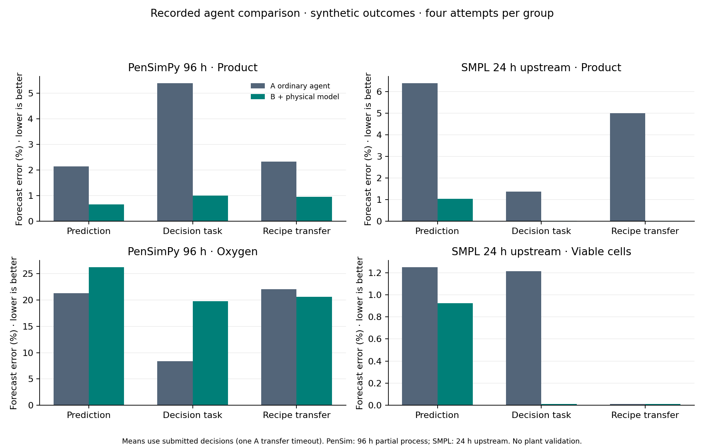

# Executed external-simulator agent pilot

Run status: **complete**. Completed **47/48** planned attempts. Model: `modal/zai-org/GLM-5.3`.

**All prediction targets and process outcomes here are simulated.** The final comparison uses two external process models. It does not use real CHO measurements, establish actual site-transfer accuracy, or demonstrate real manufacturing improvements.

**Critical limit:** complete 230 h PenSimPy evaluation failed its raw-state check. PenSimPy scores below apply only to a separately declared 96 h partial process. SMPL scores apply only to its 17-state upstream reactor/separator for 24 h.

## What the results mean

On the prediction task, adding the tool reduced mean product error from 2.150% to 0.662% in PenSimPy, and from 6.392% to 1.045% in SMPL. PenSimPy oxygen prediction error nevertheless increased from 21.324% to 26.215%.

The model-assisted agent achieved small positive mean PenSimPy objective changes on operating and recipe-transfer tasks; SMPL action choices produced the same mean objective changes in both arms. The physics-only baseline frequently matched or exceeded the AI-assisted results. These observations support useful model access in this narrow virtual experiment, but do not establish that AI adds value beyond the model, that every prediction improves, or that the gains transfer to a real plant.

## What was compared

A: ordinary agent analysis with numerical Python. B: the same agent and public packet, plus live execution of a nominal physical model. Both have the same saved model, low reasoning setting, 120 s wall ceiling, 8 model-call ceiling and 10 analysis-tool ceiling. Actions and equations are common. Arm order is counterbalanced and sessions have no shared memory.

There are four process/regime combinations per simulator (two underlying seeds × two receiving operating factors), each reused across three tasks. Each table cell has at most four attempts. These correlated development cases do not support statistical significance or broad generalization claims.

Prediction always targets the KEEP plan, even when the agent selects another action. Operating-decision actions start after receiving measurements (80 h PenSimPy,6 h SMPL). Transfer actions start before receiving measurements; source history and changed receiving operating specifications are available. Geometry and material/strain realization remain fixed: this is simulated recipe transfer under changed operating conditions, not demonstrated scale-up or a different factory.

## Prediction error

Lower is better. Values are mean absolute errors divided by the corresponding simulated actual endpoint, shown as percentages. Failures remain in completion counts; means use valid submissions only. Product and process-indicator errors are separate endpoints.

| Simulator | Task | Completed A/B | Product error A | Product error B | Indicator error A | Indicator error B |
|---|---|---|---:|---:|---:|---:|
| PenSimPy 96 h | Prediction | 4/4 / 4/4 | 2.150% | 0.662% | 21.324% | 26.215% |
| PenSimPy 96 h | Operating decision | 4/4 / 4/4 | 5.392% | 1.010% | 8.343% | 19.749% |
| PenSimPy 96 h | Simulated recipe transfer | 3/4 / 4/4 | 2.330% | 0.961% | 22.036% | 20.615% |
| SMPL 24 h upstream | Prediction | 4/4 / 4/4 | 6.392% | 1.045% | 1.249% | 0.925% |
| SMPL 24 h upstream | Operating decision | 4/4 / 4/4 | 1.381% | 0.023% | 1.212% | 0.011% |
| SMPL 24 h upstream | Simulated recipe transfer | 4/4 / 4/4 | 5.004% | 0.023% | 0.011% | 0.011% |

The indicator is endpoint dissolved oxygen (mg/L) for PenSimPy and viable cell concentration (cells/L) for SMPL. Product is penicillin g/L or reactor mAb mg/L, respectively.

## Did selected actions improve the simulated objective?

Positive changes beat KEEP in the same actual realization. These objectives are not product quality, commercial yield, validated safety, or real batch success. PenSimPy maximizes96 h concentration. SMPL maximizes integrated physical product-outlet mass over the post-decision horizon (18 h for an operating decision,24 h for transfer).

| Simulator | Task | Improved actions A/B | Mean objective change A | Mean objective change B |
|---|---|---|---:|---:|
| PenSimPy 96 h | Operating decision | 1/4 / 3/4 | -0.0341% | +0.0129% |
| PenSimPy 96 h | Simulated recipe transfer | 0/4 / 4/4 | -0.1812% | +0.4629% |
| SMPL 24 h upstream | Operating decision | 4/4 / 4/4 | +0.2788% | +0.2788% |
| SMPL 24 h upstream | Simulated recipe transfer | 4/4 / 4/4 | +0.2060% | +0.2060% |

## Baselines that do not use an AI

These are scored after freezing the agent run. A last-measurement baseline uses the latest receiving observation, or completed source endpoint for transfer. The nominal-physics baseline calls the same forward-model calculation without asking an agent to interpret it. For transfer, linear extrapolation intentionally reduces to the completed source endpoint because source and receiving clocks are distinct.

| Simulator | Task | Last-measurement product error | Linear-trend product error | Physics-only product error | Physics-only selected-action change |
|---|---|---:|---:|---:|---:|
| PenSimPy 96 h | Prediction | 19.798% | 53.841% | 0.964% | +0.0000% |
| PenSimPy 96 h | Operating decision | 19.798% | 53.841% | 0.964% | +0.0129% |
| PenSimPy 96 h | Simulated recipe transfer | 0.750% | 0.750% | 0.964% | +0.4629% |
| SMPL 24 h upstream | Prediction | 1.038% | 6.238% | 0.022% | +0.0000% |
| SMPL 24 h upstream | Operating decision | 1.038% | 6.238% | 0.022% | +0.2788% |
| SMPL 24 h upstream | Simulated recipe transfer | 7.653% | 7.653% | 0.022% | +0.2060% |

An agent that only copies or selects the model outputs has not demonstrated extra value over the physics-only baseline. The small action grid is deliberately limited and is not arbitrary autonomous process design.

## Integrity and numerical checks

- Identical paired packet hashes: **True**.
- Identical shared tool schemas: **True**.
- Independent arithmetic checks on submissions and physical trajectories: **141 passed**.
- OS probes deny evaluator files, private source, nominal-model files and network access from numerical Python; SDK active tools are allowlisted.
- Live physics workers receive the public packet and nominal model configuration, never the actual evaluation seed or targets. Workers have stripped credential environments and separate processes for native-global safety.
- Nominal assumptions are common: SMPL exact initial state is published; PenSim nominal future disturbances are disabled and flags/initial conditions/recipe/driver corrections are published.
- Both retain control/equation implementation convenience differences. A receives equations and physical assumptions, not an installed full native simulator inside its numerical sandbox. It is not a resource-matched test of abstract reasoning alone.
- Numerical consistency checks compare repeats, tighter tolerances and alternate solvers. They are not independent experimental validation.
- Shared upstream laws limit evaluator independence. Source-to-receiving realization reuse is optimistic. No independent blinded scientific adjudication was performed.

## Development failures and excluded runs

1. Stock native/source inspection revealed an integer-division cube-root discrepancy. The build preserves the original source hash and records the one-expression correction against the supplied Python equation.
2. The full 230 h trial produced a negative raw viscosity state and was rejected. The 96 h pilot is an explicit development response, not a successful full-batch result.
3. The first connectivity attempt could not apply nested sandboxing. The next exposed the temporary interpreter whitelist issue. Both failed before inference; isolation was fixed and reprobed.
4. The earlier completed 48-attempt comparison used incomplete shared nominal assumptions and cached nominal outputs. It is marked superseded, retained intact, and excluded from every table above. The final comparison uses live execution and explicitly shared nominal assumptions.
5. All final unsubmitted/failed attempts, if any, remain visible in completion counts and per-attempt records.

## Reproduce and inspect

- Dataset: `/Users/tejas/Desktop/BioDemo/backend/results/external-simulators/pilot-20261027-final`
- Final run: `/Users/tejas/Desktop/BioDemo/backend/results/external-simulators/agent-comparison-20261027-final`
- `protocol.json`: exact model, budgets, source commits, native build correction and hashes.
- `public/*/packet.json`: exactly what both agents received.
- `attempts/*/{A,B}/tools.json`: tool arguments, actual results and timing.
- `attempts/*/{A,B}/run.json`: actual submitted decision, status, usage and score.
- `evaluator/*/truth.json`: post-evaluation process traces and action outcomes; never agent input.
- `baselines.json`, `arithmetic-audit.json`: non-AI controls and numerical verification.
- See the external-simulators README and the independent source audit for commands and scientific limits.

**Unmeasured:** real engineer hours saved, actual failed batches prevented, plant-transfer readiness and provider monetary billing. A zero-priced SDK ledger is not evidence of free inference.
