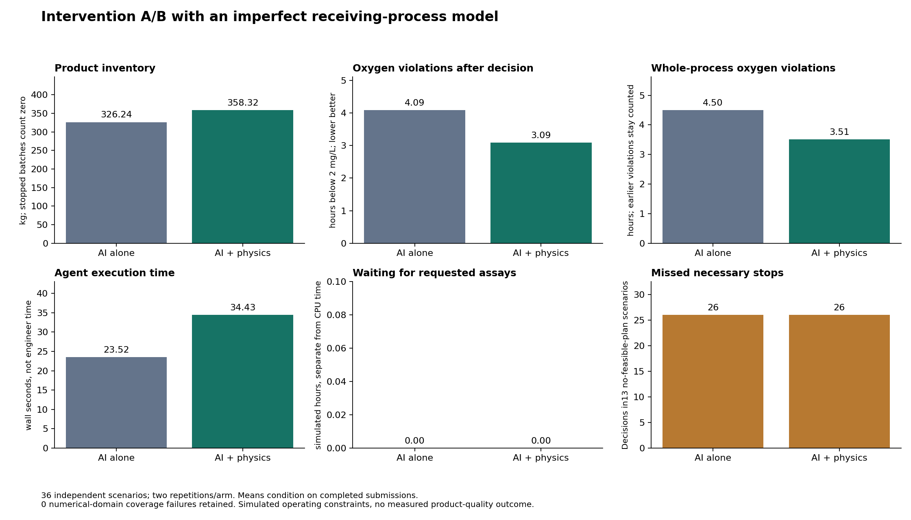

# PenSim intervention A/B: imperfect receiving model

Same AI without a supplied model versus the same AI with physics. Original recipe retained as a reference. Earlier optimizer development results remain available; this narrower study cannot establish that agents outperform conventional modeling software.

36 independent receiver scenarios, 2 AI repetitions/arm, 144 planned AI slots. 0 selected scenarios had numerical-domain coverage failures; these were not replaced or counted as correct stops.

**Physics improved recoverable interventions, but both agents failed to stop in every no-feasible-plan situation.** Across36 independent scenarios, AI + physics averaged32.09kg more product and0.99h less post-decision oxygen violation than AI alone. These are simulated outcomes, not evidence of safe autonomous operation.

## Separate outcomes

| Outcome | AI alone | AI + physics |
|---|---:|---:|
| Completed submissions | 72 | 72 |
| Mean terminal product mass (kg) | 326.239 | 358.324 |
| Mean product concentration (g/L) | 4.002 | 4.443 |
| Mean oxygen violation after decision (h) | 4.086 | 3.094 |
| Mean whole-process oxygen violation (h) | 4.497 | 3.506 |
| Operating choices with oxygen violations | 38 | 27 |
| Stops | 0 | 0 |
| Unnecessary stops within menu | 0 | 0 |
| Correct stops within menu | 0 | 0 |
| Stops/decisions with incomplete menu adjudication | 0 | 0 |
| Mean agent wall time (s) | 23.525 | 34.432 |
| Mean measurement-induced process delay (h) | 0.000 | 0.000 |
| Total assumed assay work (min) | 0.000 | 0.000 |
| Execution failures | 0 | 0 |

Means condition on completed submissions; their denominators and unattempted coverage failures appear in analysis.json. Stops contribute zero product. Product mass and constraint compliance are reported separately; an infeasible run does not become a successful intervention because it produced more material. No product-quality measurements are available. Assay work is assumed, billing unknown, and wall time is not measured engineer effort.

## Paired uncertainty

{
  "mass_B_minus_A_kg": {
    "mean": 32.08564932894607,
    "interval95": [
      13.379360788993772,
      55.813521659919495
    ],
    "independent_case_clusters": 36
  },
  "post_violation_B_minus_A_h": {
    "mean": -0.9916666666666667,
    "interval95": [
      -1.5722222222222224,
      -0.4222222222222223
    ],
    "independent_case_clusters": 36
  }
}

Intervals resample independent scenarios with repetitions nested. They are exploratory and conditional on paired completed scenarios, not calibrated physical confidence or proof of general manufacturing benefit.

## Evidence and boundaries

Source calibration uses three completed source batches, DO and delayed product assays; no perfect substrate measurement. Receiver initial states and kinetics differ; the tool never receives hidden true parameters or future observations. Candidate change-time fitting and a fixed sensitivity set use only available observations. Sensitivity members are not probabilities of feasibility.

The predeclared normal/moderate/severe mix describes disturbance assumptions, not guaranteed recoverability. Severe numerical failures expose model-domain gaps, not physically established unrecoverable conditions. Full230h viscosity remains unresolved; the horizon here is96h. Source-model kinetic ranges/noise/action limits are synthetic assumptions informed by the port, not empirically validated receiver distributions.

The research SDK demonstrates an investigation/recommendation interface; this is not an end-to-end production OS deployment or a real intervention. The physical NISTCHO dataset is a separate, campaign-confounded feeding comparison and cannot validate this oxygen mechanism.

All source snapshots, protocol hashes, input packets, tool events, recommendations, hidden action replays and failures remain in the study directory. The prior matching-model benchmark remains the upper-bound reference.

## Original recipe reference

36 admitted independent scenarios: mean terminal mass 320.017kg; mean post-decision oxygen violation 3.039h; 19 scenarios violate the oxygen limit. These are unmodified-recipe outcomes, not another AI arm.

## Realized recoverability: independent scenarios and AI repetitions

The mix was selected before evaluation as12normal,12moderate-loss and12severe-loss scenarios. Hidden dynamics determined actual recoverability; no seeds were replaced to force desired labels. At the initial52h decision:

| Hidden process condition | Independent scenarios | AI alone: feasible decisions | AI + physics: feasible decisions |
|---|---:|---:|---:|
| Original recipe feasible |17|32/34|34/34|
| Adjustment can recover the process |6|2/12|11/12|
| No permitted operating plan is feasible |13|0/26|0/26|

Each scenario has two AI repetitions. The11/12versus2/12recovery result concerns only **six independent recoverable scenarios**, so it is not a definitive generalization estimate. Both agents continued in all26decisions where no plan was feasible. Neither requested an extra assay. Zero unnecessary stops therefore must not be interpreted as demonstrated stopping judgment. Avoiding the need for a stop was not possible in these13scenarios under the frozen action menu.

## Scope change and remaining stages

The primary comparison was narrowed before final-case generation at the user’s request. It tests whether physics helps the same AI; it does not establish that agents add value beyond conventional modeling software. The earlier model-plus-optimizer development result is retained in [the development replay](../../research/intervention-development-workflow-20261029.md).

The selected [published physical oxygen-correction replay](../physical-oxygen-summary-20261029/report.md) is complete. Both agents deferred for characterization and equipment review; neither used the optional physics tool. It provides no observed model-access benefit and is not a newly executed experiment.

SMPL partial observations, latent-state/kinetic uncertainty and aggregate forecast interface are implemented and numerically tested, but a new comparative SMPL intervention study has not been run. The existing realCHO protocol already holds whole experiments out for growth/glucose prediction; no new product/intervention result is inferred. The problematic feeding export remains preserved with quality flags, not promoted into a mechanistic physical replay.

## Why the stopping result matters

A read-only diagnostic of all26model-enabled decisions in no-feasible-plan situations found that the agent had queried its selected plan and the central model predicted it infeasible every time. The agents nevertheless chose to continue, sometimes appealing to a feasible member in the uncalibrated sensitivity set or to preserving product mass. This is a failure of the configured recommendation policy to enforce the simulated constraint; it cannot be explained solely as missing model access.

The frozen system prompt instructed avoiding violations and retaining mass, but did not formalize lexicographic feasibility priority or a mandatory stop rule under uncertainty. Consequently this test does not prove that agents are inherently unable to stop. It shows that this configuration is inadequate for autonomous constraint enforcement. A clearer policy and a fresh, separately frozen evaluation would be needed; no prompt correction or favorable rerun was applied to these results. The measurement menu also allowed only an extra product assay, not a direct oxygen-transfer diagnostic, and no agent requested it.
