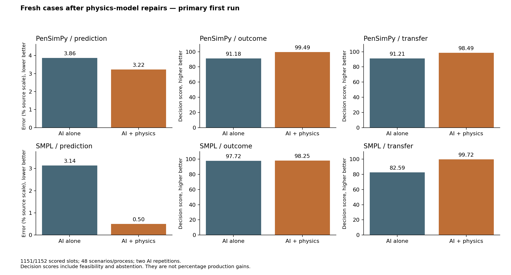

# Physics-model repairs: fresh AI A/B experiment

Primary first-run results. 28 October2026 protocol; actual execution timestamps are in the run receipts.

**1151/1152 planned slots scored.** 0 selected task cases lacked qualified forecast truth.

**The repaired experiment does not meet the stated all-three-aspects criterion in both processes.**

The physics arm had a better average result in all six comparisons. The strongest evidence was SMPL forecast error reduction (84.0%) and simulated recipe-transfer score improvement (+17.1 points). PenSim operating and transfer scores improved with intervals above zero, but their lower bounds did not exceed the predeclared five-point useful-effect threshold. PenSim forecast improvement remained uncertain, and SMPL operating choices were already near the best grid outcome with AI alone.

The main comparison is AI alone versus the same AI with a live physics tool. Model-only checks below explain the repair; they do not replace this comparison. Every new result and failure is retained. No simulated result overturns the earlier real-CHO findings.

| Process | Aspect | AI alone | AI + physics | Benefit [95% interval] | Cases | Threshold met? |
|---|---|---:|---:|---:|---:|---|
| PenSimPy | prediction | 3.862 | 3.225 | 16.501 % error reduction [-0.271, 30.429] | 48 | No |
| PenSimPy | outcome | 91.182 | 99.485 | 8.303 score points [2.220, 16.208] | 48 | No |
| PenSimPy | transfer | 91.209 | 98.492 | 7.283 score points [2.268, 13.814] | 48 | No |
| SMPL | prediction | 3.138 | 0.503 | 83.965 % error reduction [74.011, 92.540] | 48 | Yes |
| SMPL | outcome | 97.719 | 98.250 | 0.531 score points [-0.101, 1.207] | 48 | No |
| SMPL | transfer | 82.589 | 99.722 | 17.133 score points [6.860, 27.670] | 48 | Yes |

Prediction columns are mean absolute error as a percentage of visible completed-source scale, averaging both variables at three future times; lower is better. Benefit is relative error reduction. Decision columns are scores0–100; higher is better. Feasible product is divided by the best feasible product in the fixed grid. Invalid plans and failed sessions score0. Correct abstention scores100 only if no grid plan is feasible, and produces no product. These scores are not production percentages.

The fixed exploratory rule requires the lower95% case-bootstrap bound above20% error reduction and5 decision-score points for all six process/aspect contrasts, at least95% completion, and no unscorable selected cases. Intervals are unadjusted, not a familywise confirmatory test. Only completed paired sessions have forecast errors; failed decisions stay in the denominator. No optional sample extension or target selection was performed.

## What was repaired

- PenSim’s artificial reset of positive oxygen below2mg/L to exactly1mg/L is removed in the versioned adapter. Raw nonnegative ODE oxygen is preserved across controller intervals in source, evaluator, tool and fit. Negative/nonfinite states are rejected. Raw low-oxygen intervals and prevented resets remain audited; the2mg/L operating constraint still makes low-oxygen choices infeasible.
- PenSim now fits the current completed source product, oxygen and substrate trajectories jointly, including the existing production kinetic factor inside the coupled equations. The earlier method borrowed another batch’s calibration and omitted the product trajectory. Endpoint product multipliers and oxygen offsets are removed. Effective parameters are not claimed to be uniquely identified biology.
- SMPL now uses its common observed initial state without adding the obsolete correction for a different nominal initialization. All seventeen state components and calibration lineage are checked.
- Both arms receive explicitly separated source and receiving operating plans. Tool outputs identify which action they forecast; submitted forecasts always concern KEEP. This clarification changes both arms from the earlier study, so differences across studies are not an isolated causal effect of one repair.

See the [diagnosis](../../research/operating-challenges-diagnosis-20261028.md) for red/green evidence and counterexamples. The full230h negative-viscosity failure remains unresolved and rejected before clipping. These repairs do not qualify full-batch PenSim or real manufacturing.

## Experiment setup

48 fresh situations per process, seeds9001–9048; three tasks and two AI repetitions/arm/task yield288 packets and1152 planned sessions. Every fourth case is an ordinary control; the rest use the same predeclared transitions/constraints as the earlier suite. No case is replaced based on outcome. Repetitions are averaged within scenarios before20,000 paired bootstrap draws.

PenSim forecasts P(g/L) and DO(mg/L) at64/72/96h after a60h decision. SMPL forecasts reactor antibody(mg/L) and viable cells(cells/L) at8/12/24h; operating decisions begin at6h, transfer at0h. PenSim objective is partial-process terminal concentration; SMPL objective is the post-change external separator product-mass integral. Neither is a real manufacturing intervention.

Transfer means changed operating plans at the same geometry/biology; no receiving observations. Source/receiver share a latent biological/disturbance realization in PenSim; SMPL shares the openly measured initial state and deterministic equations. This optimistic recipe-adaptation proxy is not receiving-site or scale-up validation.

Both arms receive byte-identical observations, schedules, units and bounds, the same saved AI, ordinary numerical Python,8 model calls,10 tool calls,8192 output tokens and120-second session ceilings. Only B has a physics tool. Source-only fitting adds offline model-preparation compute for B; equal AI request limits do not equal total computation. The worker gets no realization seed or receiving truth and must reproduce frozen model outputs. OS probes block numerical-tool access to evaluator files, models, credentials and network.

The source fit and statistical plan were frozen before new AI inference. The process equations, calibration algorithm and selected cases remain frozen during inference. See the [protocol](../../research/model-repair-protocol-20261028.md). Original results stay in the [prior report](../operating-challenges-20261028/report.md).

## Model checks, separate from AI outcomes

| Process | Old-model error on fresh cases | Repaired-model error |
|---|---:|---:|
| PenSimPy | 36.829% source scale | 4.111% source scale |
| SMPL | 2.182% source scale | 0.000% source scale |

These compare tool forecasts against the simulator on the same fresh cases. SMPL agreement is expected when the same equations, known initial state and commands are used. It is not external validation.

PenSim source fit failures: 0; optimizer nonconvergence: 1; fits near at least one parameter bound: 15. Mean source MAE: product 0.105g/L, oxygen 0.236mg/L, substrate 0.029g/L. Optimizer convergence alone does not establish trajectory accuracy or parameter identifiability.

## Completion, failures and verification

11238 independent input, arithmetic and model-hash checks passed. B used physics in 576 sessions with 1608 calls; 0 tool errors are retained. 0 audit entries were unavailable for failed sessions.

Failure counts: {"Request was aborted": 1}.

49 software/physics regression checks passed, with one expected failure retaining the unqualified230h model. Numerical preflight compares an independent solver; common-input and exact-clock checks cover every admitted task packet. These gates establish software/numerical consistency, not empirical model quality.

All source snapshots, manifests, fit receipts, common packets, tool/event logs, submissions and failed cases are retained under `backend/results/external-simulators/model-repair-continuous-20261028/`. Billing and human time savings are unmeasured.

## All targets and decision details

[Every forecast target](all-forecast-targets.csv), [every case](case-results.csv), [full analysis including strata and failures](analysis.json), and [model diagnostics](model-diagnostics.json) are available. These include negative effects, not just favorable endpoints.

| Process / task | Arm | Failed | Invalid | Correct abstention | Unnecessary abstention | Feasible choices |
|---|---|---:|---:|---:|---:|---:|
| PenSimPy / outcome | A | 0 | 6 | 0 | 0 | 90 |
| PenSimPy / outcome | B | 0 | 0 | 2 | 0 | 94 |
| PenSimPy / transfer | A | 0 | 6 | 0 | 0 | 90 |
| PenSimPy / transfer | B | 0 | 1 | 2 | 0 | 93 |
| SMPL / outcome | A | 0 | 0 | 0 | 0 | 96 |
| SMPL / outcome | B | 0 | 0 | 0 | 0 | 96 |
| SMPL / transfer | A | 0 | 16 | 0 | 0 | 80 |
| SMPL / transfer | B | 0 | 0 | 16 | 0 | 80 |

## Remaining limits

Hidden morphology and future disturbances, empirical rheology, shared evaluator/model equations, finite control choices and optimistic same-biology transfer limit generalization. The separately tested real CHO-K1 batch model remains a simple growth/glucose approximation with omitted nutrients/stress. Its earlier negative empirical results remain valid for that configuration. This simulator study provides no new empirical CHO measurement comparison.

## Source-admission correction and retained partial run

A post-freeze audit of the first repair dataset found9/48 completed-source PenSim trajectories with artificial oxygen-floor events. The generator had checked receiving KEEP but omitted the same source gate. The partial AI run was stopped before comparative scores were inspected:224 attempts,213 completed submissions,11 interrupted/failed. Those records remain under `backend/results/external-simulators/model-repair-20261028/`; they are superseded and are not pooled here.

This replacement declares source feed1 and air1.15 after60h for every PenSim case, using the existing action envelope. Both arms receive that plan and fitting uses it exactly. This changes the source operating condition to avoid a known invalid domain; it does not repair the low-oxygen constitutive behavior. Every source is admitted and replayed independently before inference. Cases failing source or receiver admission remain in coverage accounting without replacement.

The replacement seeds9001–9048 and source rule were recorded before generation. Other algorithm bounds, endpoints, comparisons and analysis stayed fixed. See the [source-admission addendum](../../research/model-repair-source-admission-20261028.md).

## Oxygen reset: final numerical correction

The source-air change alone still exposed one clipped source, seed9014. That intermediate generation had zero AI attempts. A minimal replay showed1.9922505097mg/L computed oxygen being overwritten with1mg/L. The final adapter preserves the computed state and matches an independent Python solver across the96h trajectory. Legacy reset behavior remains available for historical replay.

The same9001–9048 cases were regenerated, not resampled. Source9014 informed numerical debugging, so these cases are not a wholly untouched confirmatory set, although no AI scores from them were inspected before freezing this version. The source-air rule remains1.15 after60h and is disclosed to both arms. Sources now require a finite nonnegative trajectory without artificial oxygen resets; low oxygen is recorded rather than silently raised or hidden.

The model-only comparison above replays older calibration with this same corrected oxygen adapter. It isolates calibration/initialization differences on the final cases, rather than reproducing every defect of the earlier complete pipeline. See the [continuous-oxygen protocol](../../research/model-repair-continuous-oxygen-20261028.md) for the precise correction and retained intermediate failures.

## Practical interpretation

SMPL transfer gains largely concern recognizing infeasible situations: A selected16 invalid plans; B correctly abstained16 times. Abstention produces no product. PenSim likewise reduced invalid choices and sometimes correctly abstained. These results support better constrained decisions in this simulated setting; they do not establish the same percentage increase in manufactured output.

The single failed session was an AI-alone prediction timeout in repeat2 of case NC-1223eb1ea8c1. It remains a failure; no retry was performed. Prediction uncertainty averages paired completed repetitions, with both repetitions nested within each of the48 situations. The one nonconverged source fit and15 fits near parameter bounds remain in the study and are disclosed above.
