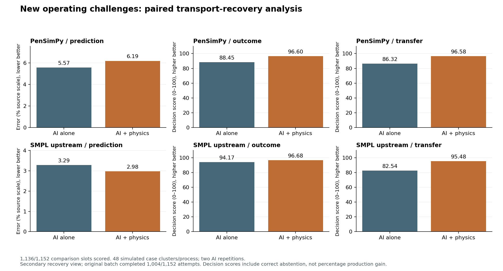

# AI with and without physics: operating challenges

28 October 2026. A new experiment set, using frozen physical models. Result tables here contain only this new set; every new outcome is included. Earlier studies remain preserved separately.

This report's main tables are a **secondary paired transport-recovery analysis**, not a successful first-run reliability result. The original batch completed **1,004/1,152** attempts. A single extra pass ran **136** attempts for pairs affected by connection errors. Both arms were repeated; every selected retry pair is used regardless of whether its scores improve or worsen. No models or cases changed. Original results are shown below and preserved in full.

## What this run establishes

After recovery, **1,136/1,152** original case/arm/repetition slots have a scored submission; 16 failed submissions; 0 unscorable selected task cases.

**The recovered analysis does not establish improvement in all three aspects under the stated criterion.**

This is controlled simulation evidence. The physics tool and evaluator share equations, so success does not establish real manufacturing accuracy or real site-transfer readiness. No real CHO measurements were tested in this new run.

## Main results

A is the configured AI without a supplied physics model. B is the same AI plus a live physics tool. Both receive identical raw observations, source history, plans, limits, units, ordinary numerical Python and request budgets.

| Process | Aspect | AI alone A | AI + physics B | Benefit [95% case-bootstrap interval] | Cases | Criterion met? |
|---|---|---:|---:|---:|---:|---|
| PenSimPy | Forecast error (% source scale; lower better) | 5.570 | 6.189 | -11.123% relative error reduction [-29.109, 5.139] | 48 | No |
| PenSimPy | Operating decision score (0–100; higher better) | 88.447 | 96.602 | 8.155 score points [2.981, 14.950] | 48 | No |
| PenSimPy | Recipe adaptation score (0–100; higher better) | 86.321 | 96.581 | 10.260 score points [4.045, 17.997] | 48 | No |
| SMPL upstream | Forecast error (% source scale; lower better) | 3.290 | 2.975 | 9.552% relative error reduction [-2.174, 19.815] | 48 | No |
| SMPL upstream | Operating decision score (0–100; higher better) | 94.171 | 96.677 | 2.506 score points [-1.793, 7.972] | 48 | No |
| SMPL upstream | Recipe adaptation score (0–100; higher better) | 82.544 | 95.476 | 12.932 score points [4.454, 23.050] | 48 | No |

Forecast error averages both variables at three future times, normalized by each variable’s visible completed-source median. Forecast benefit is relative error reduction. Only completed paired sessions have numerical forecast errors; failures remain in completion counts. Decision scores include failed submissions as zero. The stated useful-effect thresholds are 20% error reduction and 5 score points for each decision aspect; the interval lower bound must exceed the threshold. The all-three claim requires all aspects in both processes to pass, at least 95% completion, and no unscorable selected cases.

The score rewards a feasible plan’s product relative to the best feasible plan in the fixed private grid. An invalid plan scores zero. Correct abstention scores 100 only when no process plan can meet the study limits; abstention produces no product. Thus higher decision score must not be described as the same percentage increase in manufacturing production.

## Experiment setup

- 48 new seeded situations per simulator, seeds 7001–7048; each supplies prediction, outcome and transfer tasks. Two independent AI sessions per arm/task: 288 task packets and 1,152 planned attempts. Repetitions are nested inside situation clusters. These are simulated situations with repeated factorial regimes, not 96 biological experiments.
- Every fourth case is an ordinary comparison; the rest involve declared changes/constraints. All selected cases are retained without resampling until a favorable result appears.
- PenSim: changed sugar/aeration plans after 60 h, forecasts at 64/72/96 h. Decisions choose materially different allowed plans. The endpoint is penicillin concentration, not recovered mass or full-batch yield.
- SMPL: balanced throughput and nutrient plans, forecasts at 8/12/24 h. Operating decisions begin at 6 h; transfer plans begin at 0 h. Its 17-state upstream reactor/separator is used; harvested product is the external separator outflow integral in mg.
- Each session commits one plan from a finite grid. Its consequences are scored against trajectories frozen before inference and hidden until submission; this is not continuous closed-loop control.
- Transfer has no receiving observations. It changes permitted operating/resource plans at fixed geometry/biology. SMPL explicitly shares the measured source initial inoculum with the receiver; this optimistic assumption is given to both arms. PenSim source and receiver also share a latent material/disturbance seed, so their prechange paths can be identical; this is not independent receiving-site variability. This is a simulated recipe-adaptation proxy.
- Command limits are permitted-plan/resource requirements. KEEP forecasts may be counterfactual where KEEP violates those requirements. They are not measurements of an executable/approved plan, and no additional actuator-saturation law is modeled.
- Existing equations, coefficients, native corrections and earlier calibration values are frozen. No fitting or parameter tuning was performed. Calibration comes deterministically from the first prior prediction case in catalogue order for each process. It may fit a new situation poorly; it was not chosen using new outcomes. SMPL’s observed source initial state is an ordinary scenario input.
- Tool/evaluator action meanings match. B’s live worker receives no realization seed, receiving future, outcome table or optimal-action ranking. Its predictions are checked against frozen nominal records.

## Every forecast target

Lower source-normalized error is better. This table includes all targets for the prediction task; the downloadable CSV includes all targets in all three tasks.

| Process | Variable | Time (h) | A error (% source scale) | B error (% source scale) | Error reduction (%) |
|---|---|---:|---:|---:|---:|
| SMPL upstream | Product | 8 | 3.407 | 3.322 | 2.520 |
| SMPL upstream | Product | 12 | 6.188 | 5.400 | 12.735 |
| SMPL upstream | Product | 24 | 7.765 | 6.249 | 19.524 |
| SMPL upstream | Viable cells | 8 | 0.312 | 0.812 | -160.420 |
| SMPL upstream | Viable cells | 12 | 0.613 | 0.901 | -47.099 |
| SMPL upstream | Viable cells | 24 | 1.453 | 1.169 | 19.584 |
| PenSimPy | Oxygen | 64 | 2.779 | 3.129 | -12.595 |
| PenSimPy | Oxygen | 72 | 3.331 | 3.702 | -11.130 |
| PenSimPy | Oxygen | 96 | 14.386 | 14.360 | 0.175 |
| PenSimPy | Product | 64 | 3.386 | 4.843 | -43.024 |
| PenSimPy | Product | 72 | 4.540 | 6.131 | -35.033 |
| PenSimPy | Product | 96 | 4.997 | 4.971 | 0.521 |

## Ordinary versus challenge cases

Both predeclared strata are reported; neither is discarded to improve the headline. Benefit is forecast-error reduction or change in decision-score points.

| Process | Task | Stratum | Cases | Benefit | 95% interval |
|---|---|---|---:|---:|---|
| PenSimPy | prediction | ordinary | 12 | 6.083 | [-17.900, 29.322] |
| PenSimPy | prediction | challenge | 36 | -14.895 | [-36.168, 4.083] |
| PenSimPy | outcome | ordinary | 12 | 11.672 | [2.681, 28.233] |
| PenSimPy | outcome | challenge | 36 | 6.982 | [1.629, 14.070] |
| PenSimPy | transfer | ordinary | 12 | 15.729 | [3.448, 35.177] |
| PenSimPy | transfer | challenge | 36 | 8.437 | [1.692, 16.990] |
| SMPL upstream | prediction | ordinary | 12 | -23.186 | [-85.673, 20.721] |
| SMPL upstream | prediction | challenge | 36 | 11.733 | [0.208, 21.768] |
| SMPL upstream | outcome | ordinary | 12 | 8.268 | [-0.484, 24.695] |
| SMPL upstream | outcome | challenge | 36 | 0.586 | [-3.635, 4.681] |
| SMPL upstream | transfer | ordinary | 12 | -3.005 | [-11.938, 1.963] |
| SMPL upstream | transfer | challenge | 36 | 18.244 | [7.203, 30.709] |

## Failures, infeasibility and model limits

| Process / task | Arm | Failed submissions | Invalid decisions | Correct abstentions | Unnecessary abstentions | Feasible process choices |
|---|---|---:|---:|---:|---:|---:|
| PenSimPy / outcome | A | 0 | 9 | 0 | 0 | 87 |
| PenSimPy / outcome | B | 0 | 3 | 0 | 0 | 93 |
| PenSimPy / transfer | A | 0 | 9 | 0 | 2 | 85 |
| PenSimPy / transfer | B | 0 | 3 | 0 | 0 | 93 |
| SMPL upstream / outcome | A | 4 | 0 | 0 | 0 | 92 |
| SMPL upstream / outcome | B | 2 | 0 | 0 | 0 | 94 |
| SMPL upstream / transfer | A | 1 | 15 | 0 | 0 | 80 |
| SMPL upstream / transfer | B | 0 | 4 | 13 | 0 | 79 |

Oxygen-floor or raw invalid trajectories cannot become successful operating outcomes. Unqualified actions score zero even if the upstream simulator displays a higher product value. The complete 230 h viscosity defect remains unresolved; this report concerns only the declared 96 h partial process. SMPL’s tested nutrient terms are near saturation and some plans have obvious rankings; the benchmark does not establish that all its decisions are difficult. Study limits are not validated manufacturing safety/quality limits.

Failed submissions are retained in [analysis.json](analysis.json). All case-level scores and grid qualification counts are in [case-results.csv](case-results.csv). All forecast targets, including negative effects, are in [all-forecast-targets.csv](all-forecast-targets.csv).

## Verification and statistical limits

11,125 arithmetic, input and model-hash checks passed for the available records. B used physics in 570 sessions, with 1710 live queries and 0 tool errors. Source snapshots, manifests, isolation probes, frozen inputs, tool/event logs and submissions are retained under backend/results/external-simulators/challenges-20261028.

The sample count and meaningful-effect thresholds were frozen before generating cases. The analysis addendum defining aggregation/bootstrap details was written after inference started but before inspection of any A/B scores; this was not independently preregistered. This is a fixed-sample exploratory report, not a power-qualified definitive demonstration. Confidence intervals resample whole synthetic case clusters with AI repetitions kept together; shared equations and repeated regimes limit generalization. No optional sample extension or favorable-target selection was performed.

2 audit entries are unavailable for failed sessions and are listed in analysis.json. The original runner's per-pair exception handling could stop its combined progress update while other scheduled workers continued. Final totals are reconciled from durable original run receipts; lost/unknown results are conservatively failures, with no lost result imputed as a success. Fresh sessions in the explicitly declared paired recovery pass are separate attempts; prior session state is never reused. The original exception, incomplete summary and reconciliation receipt are preserved.

Checks establish numerical/software consistency and input isolation, not independent physical accuracy. Earlier empirical and simulator reports remain available in the [historical study](../physics-improvements-20261028/report.md); this new report does not retire or invalidate them. Model changes and new independent empirical validation remain separate future work.

## Original batch and recovery: both retained

The original batch had 148 failed/unknown submissions. These included 123 recorded connection errors, 23 timeouts and 2 lost runner results conservatively scored as failures. Only pairs containing an exact connection error and no accepted decision were eligible for the one recovery pass. Ordinary timeouts and poor operating decisions were not independently selected for retries. A timeout counterpart could be repeated only because the whole connection-affected pair was repeated.

The revised view always takes both arms from each selected retry pair. It does not take the better of an old and new score. Thus recovery adds inference attempts, not independent process cases. The original batch’s 87% first-run completion must not be replaced with the recovered view’s completion as a reliability claim.

| Process | Aspect | Original A | Original B | Original benefit | Recovered A | Recovered B | Recovered benefit |
|---|---|---:|---:|---:|---:|---:|---:|
| PenSimPy | prediction | 5.570 | 6.189 | -11.123 | 5.570 | 6.189 | -11.123 |
| PenSimPy | outcome | 88.447 | 96.602 | 8.155 | 88.447 | 96.602 | 8.155 |
| PenSimPy | transfer | 86.321 | 96.581 | 10.260 | 86.321 | 96.581 | 10.260 |
| SMPL upstream | prediction | 3.412 | 3.148 | 7.710 | 3.290 | 2.975 | 9.552 |
| SMPL upstream | outcome | 71.804 | 72.980 | 1.176 | 94.171 | 96.677 | 2.506 |
| SMPL upstream | transfer | 62.003 | 72.670 | 10.667 | 82.544 | 95.476 | 12.932 |

Forecast values are percentage source-normalized error and benefits are percentage relative error reduction. Decision values/benefits are 0–100 scores/score points, not production percentages. Original intervals, every failure and all targets remain in the [original-batch report](../operating-challenges-initial-20261028/report.md). The recovered tables and JSON retain any remaining unsuccessful sessions.

The first recovery setup failed a local path preflight before any AI sessions started; that setup directory is retained. The corrected setup performed the single scheduled recovery pass. The original runner’s BrokenPipe exception and incomplete aggregate are retained with the reconciled result. Historical studies were not deleted.

Known physics queries across all actual attempts: 1506 original + 217 recovery = 1723. The 1710 queries in the main verification section refer to the secondary comparison view, not all execution cost.

1 original lost-result session(s) were repeated only as the counterpart of a connection-affected pair. Their original decisions remain unknown and failed in the original report; the fresh sessions do not recover those lost decisions.
