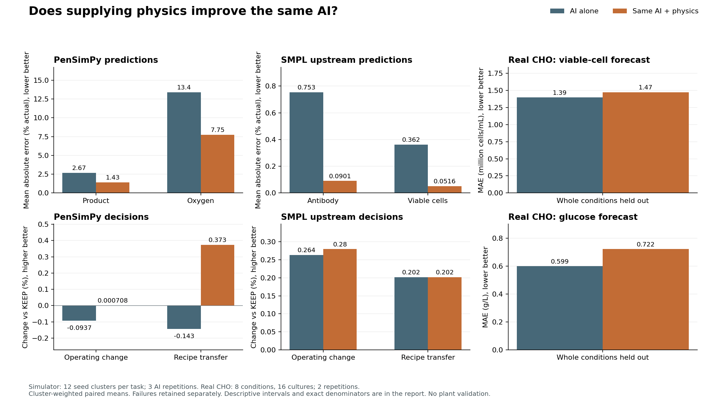

# Physics model evaluation improvements — 28 October 2026

The main comparison is the same configured AI with a physics-model tool (B) versus without a supplied model (A). Identical raw evidence, numerical tools, model, limits and fresh sessions. All attempts, including failed ones, are retained. This is a retrospective exploratory evaluation, not manufacturing validation.

The fresh simulator tests favor physics for product forecasts. PenSim oxygen errors are lower on average, but their intervals include no benefit. PenSim decision gains remain small; SMPL decision gains are mostly ties. Real CHO forecasts have higher average errors with this physics model. The full 230 h PenSim batch remains unqualified.

## Diagnosis and corrections

The original oxygen calibration added an endpoint error from the source process to the receiving process after changing aeration. That correction need not obey the receiving oxygen balance. The corrected tool fits kLa and growth factors inside the ODE using completed source measurements only. No receiving targets fit those factors. On four previously inspected diagnostic cases, tool oxygen relative error averaged 20.62% with the additive offset versus 9.07% after source-only fitting (nominal uncalibrated 10.00%). One corrected case still has 33.60% error. These old cases are development evidence only. Product calibration remains a source endpoint ratio. Parameter identifiability is not established.

The 230 h PenSim batch still fails: viscosity crosses below zero around 148.8 h. Native 1e-7, tighter 1e-9 and independent Python LSODA 1e-8 all reproduce it; the viscosity derivative at zero is negative during water addition. This is a structural domain problem in the empirical law. No arbitrary clipping or unvalidated replacement is claimed as a fix. All scored PenSim cases remain explicitly 96 h partial processes.

A second admission error surfaced during fresh generation: Q is a signed net-heat integral, not a nonnegative material concentration. The old broad guard rejected seed 3004 solely for negative Q. The source equations include cooling and never use Q as an input. The corrected guard permits signed Q while continuing to reject negative viscosity/material states. Before/after reproduction and regressions are retained. That guard was corrected before AI inference; no AI outcome was used to select it. Failed dataset generations remain available.

## Fresh simulator experiment

12 new seeds 3001..3012 per simulator; one aeration/flow factor per seed; prediction, operating decision and changed-recipe transfer tasks; three separate AI sessions per arm and case. 72 cases and 432 planned agent attempts. Receiving interventions use the original fixed action grid. SMPL is the 17-state upstream reactor/separator only. Transfer changes commands in the same geometry; it is not real-site transfer or scale-up. Independent sample size is 12 seed clusters per simulator/task, not 36 AI repetitions.

Prediction errors below are percent of actual endpoint magnitude; lower is better. Objective values are percent change versus KEEP; higher is better. Differences are B minus A; A and B means weight each seed equally after averaging its completed pairs. Bootstrap intervals resample seed clusters, preserving repetitions.

| Process / task | Measure | AI alone A | AI + physics B | B−A [descriptive 95% interval] | Clusters |
|---|---|---:|---:|---:|---:|
| SMPL upstream / outcome | Product error (%) | 2.9011 | 0.0323 | -2.8689 [-4.5935, -1.2275] | 12 |
| SMPL upstream / outcome | Cell-count error (%) | 0.7327 | 0.0170 | -0.7157 [-1.0087, -0.4430] | 12 |
| SMPL upstream / outcome | Objective change (%) | 0.2636 | 0.2797 | 0.0162 [0.0000, 0.0404] | 12 |
| SMPL upstream / prediction | Product error (%) | 0.7529 | 0.0901 | -0.6629 [-0.8862, -0.4516] | 12 |
| SMPL upstream / prediction | Cell-count error (%) | 0.3622 | 0.0516 | -0.3105 [-0.5299, -0.1653] | 12 |
| SMPL upstream / transfer | Product error (%) | 7.1731 | 0.0317 | -7.1414 [-9.4932, -4.8795] | 12 |
| SMPL upstream / transfer | Cell-count error (%) | 0.9592 | 0.0170 | -0.9422 [-1.3107, -0.6036] | 12 |
| SMPL upstream / transfer | Objective change (%) | 0.2021 | 0.2021 | 0.0001 [-0.0162, 0.0164] | 12 |
| PenSimPy / outcome | Product error (%) | 2.9237 | 1.4661 | -1.4576 [-2.4207, -0.4939] | 12 |
| PenSimPy / outcome | Oxygen error (%) | 13.3850 | 9.2050 | -4.1800 [-13.6903, 6.7161] | 12 |
| PenSimPy / outcome | Objective change (%) | -0.0937 | 0.0007 | 0.0944 [0.0467, 0.1583] | 12 |
| PenSimPy / prediction | Product error (%) | 2.6692 | 1.4295 | -1.2397 [-2.0084, -0.4940] | 12 |
| PenSimPy / prediction | Oxygen error (%) | 13.3837 | 7.7516 | -5.6320 [-13.9168, 3.5818] | 12 |
| PenSimPy / transfer | Product error (%) | 7.1693 | 1.2018 | -5.9675 [-7.7440, -4.3633] | 12 |
| PenSimPy / transfer | Oxygen error (%) | 19.8277 | 8.5998 | -11.2280 [-23.2294, 2.0155] | 12 |
| PenSimPy / transfer | Objective change (%) | -0.1432 | 0.3727 | 0.5159 [0.4203, 0.6241] | 12 |

## Predictions against real CHO measurements

Batch CHO-K1 data from the [author-published dataset](https://zenodo.org/records/20829178). Raw offline measurements retain workbook/sheet/cell provenance and workbook hashes. No aligned/interpolated values are ground truth. Cells/mL are converted to million cells/mL; glucose remains g/L. A simple glucose-limited growth/death and substrate balance is fitted separately in three folds, withholding both reactors of each test experimental condition. A 72 h observation prefix conditions the held-out culture state; its future values never fit parameters. Both arms see the same raw training histories and test prefix. Later target timestamps are the original recorded times within 96..120 h.

16 scored cultures across eight conditions, two AI sessions per arm/culture: 64 planned attempts. EXP009 has no glucose target in the declared window; both reactors are excluded with a receipt, not imputed. Six fed-batch cultures are excluded because nutrient feed composition/planned inputs are insufficient. No antibody target exists in the source. This is real prediction evidence, not a real intervention or technology-transfer experiment.

| Real CHO target | MAE AI alone A | MAE AI + physics B | B−A [descriptive 95% interval] | Conditions |
|---|---:|---:|---:|---:|
| Viable cells (million/mL) | 1.3944 | 1.4702 | 0.0758 [-0.2535, 0.4121] | 8 |
| Glucose (g/L) | 0.5988 | 0.7216 | 0.1228 [0.0050, 0.2486] | 8 |

MAE units: million viable cells/mL and g glucose/L. Positive differences mean worse average error with the physics tool. Intervals resample whole EXP conditions, retaining both reactors and AI repetitions. Overlapping training folds and eight conditions mean these intervals are descriptive. The public data and unknown model pretraining prevent a claim of prospective blind validation. The simple model omits other nutrients, inhibition and environmental effects; the observed real-data result must not be generalized to every physics model.

## Completion, checks and retained evidence

- simulated: 429/432 completed; 3 failed attempts. B used physics in 216 sessions, 638 queries, 0 tool errors. 1935 arithmetic/input/split checks; all pass=True.
- real_CHO: 64/64 completed; 0 failed attempts. B used physics in 30 sessions, 30 queries, 0 tool errors. 272 arithmetic/input/split checks; all pass=True.

Additional CHO checks verified 3,364 value/time pairs against original workbook cells and 16 held-out forecasts against an independent direct-state DOP853 integration. Five oxygen correction/reproducibility checks passed. These are implementation/numerical checks, not additional independent biological samples.

AI+physics is analyzed as assigned, including B sessions that choose not to call physics. No selectively chosen successful sessions or tasks. Complete-pair effect estimates exclude unscored failures but failure counts remain in the denominator and receipts. Isolation probes deny hidden evaluator/model-file reads, simulator imports, network and credentials in numerical Python; they establish an implementation boundary, not resistance to every possible exploit. No hidden receiving trajectories or scores are returned to agents.

Regression status: 18 passed, one expected failure retaining the unresolved full 230 h viscosity defect. Tests include signed heat versus negative material/viscosity, the actual seed 3004 trajectory, glucose/cell balance units, future-prefix rejection and exclusion of supplied models from common packets. Original diagnosis receipts, failed generations, fit receipts, frozen input manifests, runner source snapshots, per-session event/tool logs and immutable submissions are under backend/results/external-simulators/improvements-20261027. Historical runs were moved to verified archives by the workspace storage migration; descriptors under backend/benchmarks/assets/external-simulators-*-archive-20261028.json retain hashes and restore locations. They were not overwritten by this work.

[Detailed CHO protocol](../../research/cho-real-prediction-protocol-audit.md). [Machine-readable analysis and independent checks](analysis.json).
