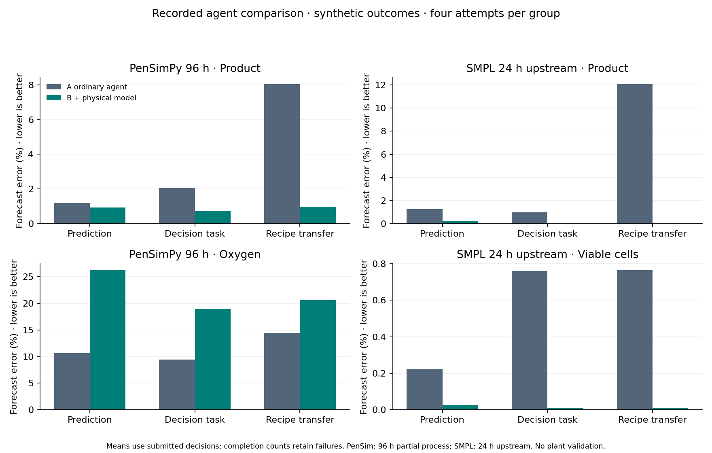

# AI with a physics model versus AI without a supplied physics model

Run status: **complete**. Completed **48/48** planned attempts. Model: `modal/zai-org/GLM-5.3`.

**All prediction targets and process outcomes here are simulated.** The final comparison uses two external process models. It does not use real CHO measurements, establish actual site-transfer accuracy, or demonstrate real manufacturing improvements.

**Critical limit:** complete 230 h PenSimPy evaluation failed its raw-state check. PenSimPy scores below apply only to a separately declared 96 h partial process. SMPL scores apply only to its 17-state upstream reactor/separator for 24 h.

The underlying simulator trajectories, receiving cases, hidden targets and scoring rules are unchanged. The corrected run protocol defines the A/B treatment and freezes the projected process packets before inference. Older dataset-generation metadata is retained for provenance; its former both-arms-model-specification description does not define these corrected agent inputs.

## Direct answer to the A/B question

B had the physics tool available and used it in **24/24 sessions**, making 71 live simulator requests. A had no physics-model tool.

On the prediction task, mean product error was 1.192% without a supplied physics model versus 0.939% with the tool for PenSimPy, and 1.257% versus 0.222% for SMPL. PenSimPy oxygen error was 10.623% versus 26.219%. Lower error is better.

The tables below compare these same two AI arms for operating decisions and simulated recipe transfer. Failures remain visible. This small, correlated, previously inspected simulation pilot does not establish statistical significance or real-factory performance.

## What was compared

**A — no supplied physics model:** the AI receives source/receiving measurements, units, operating settings, schedules, objectives and allowed actions, plus ordinary numerical Python. It receives no supplied model equations, coefficients, calibration, predictions or simulator access.

**B — physics enabled:** the same AI receives byte-identical process evidence/settings and ordinary numerical Python, plus the live physical-model tool. Model configuration and model-derived calibration are behind that tool.

 Both use the same saved AI model, low reasoning setting, 120 s wall ceiling, 8 model-call ceiling and 10 analysis-tool ceiling. Raw process data, operating settings and allowed actions are common; no equations are included in either prompt. Arm order is counterbalanced and sessions have no shared memory.

There are four process/regime combinations per simulator (two underlying seeds × two receiving operating factors), each reused across three tasks. Each table cell has at most four attempts. These correlated development cases do not support statistical significance or broad generalization claims.

Prediction always targets the KEEP plan, even when the agent selects another action. Operating-decision actions start after receiving measurements (80 h PenSimPy,6 h SMPL). Transfer actions start before receiving measurements; source history and changed receiving operating specifications are available. Geometry and material/strain realization remain fixed: this is simulated recipe transfer under changed operating conditions, not demonstrated scale-up or a different factory.

## Prediction error

Lower is better. Values are mean absolute errors divided by the corresponding simulated actual endpoint, shown as percentages. Failures remain in completion counts; means use valid submissions only. Product and process-indicator errors are separate endpoints.

| Simulator | Task | Completed A/B | Product error A | Product error B | Indicator error A | Indicator error B |
|---|---|---|---:|---:|---:|---:|
| PenSimPy 96 h | Prediction | 4/4 / 4/4 | 1.192% | 0.939% | 10.623% | 26.219% |
| PenSimPy 96 h | Operating decision | 4/4 / 4/4 | 2.045% | 0.718% | 9.429% | 18.941% |
| PenSimPy 96 h | Simulated recipe transfer | 4/4 / 4/4 | 8.036% | 0.975% | 14.468% | 20.615% |
| SMPL 24 h upstream | Prediction | 4/4 / 4/4 | 1.257% | 0.222% | 0.225% | 0.025% |
| SMPL 24 h upstream | Operating decision | 4/4 / 4/4 | 0.974% | 0.024% | 0.760% | 0.011% |
| SMPL 24 h upstream | Simulated recipe transfer | 4/4 / 4/4 | 12.060% | 0.022% | 0.764% | 0.011% |

The indicator is endpoint dissolved oxygen (mg/L) for PenSimPy and viable cell concentration (cells/L) for SMPL. Product is penicillin g/L or reactor mAb mg/L, respectively.

## Did selected actions improve the simulated objective?

Positive changes beat KEEP in the same actual realization. These objectives are not product quality, commercial yield, validated safety, or real batch success. PenSimPy maximizes96 h concentration. SMPL maximizes integrated physical product-outlet mass over the post-decision horizon (18 h for an operating decision,24 h for transfer).

| Simulator | Task | Improved actions A/B | Mean objective change A | Mean objective change B |
|---|---|---|---:|---:|
| PenSimPy 96 h | Operating decision | 0/4 / 1/4 | -0.0701% | -0.0140% |
| PenSimPy 96 h | Simulated recipe transfer | 1/4 / 4/4 | -0.1220% | +0.4629% |
| SMPL 24 h upstream | Operating decision | 4/4 / 4/4 | +0.2788% | +0.2788% |
| SMPL 24 h upstream | Simulated recipe transfer | 4/4 / 4/4 | +0.2060% | +0.2060% |

## Reading the operating-decision result

The main comparison has exactly two agent arms: A without a supplied physics model and B with the model tool. For both arms, an action improves the objective if it beats keeping the same operating plan in the same simulated realization. KEEP is the common reference for judging an action; it is not a third AI arm. Optional non-AI calculations are retained separately in `baselines.json` and do not replace or grade the main A/B comparison.

## Integrity and numerical checks

- Identical paired packet hashes: **True**.
- Identical shared tool schemas: **True**.
- Independent arithmetic checks on submissions and physical trajectories: **144 passed**.
- OS probes deny evaluator files, private source, nominal-model files and network access from numerical Python; SDK active tools are allowlisted.
- Live physics workers receive the public packet and nominal model configuration, never the actual evaluation seed or targets. Workers have stripped credential environments and separate processes for native-global safety.
- B's typed physics tool uses the nominal model parameterization plus calibration derived only from completed source history. It never uses actual receiving future outcomes. A receives none of the supplied model specification or calibration.
- A may use its learned knowledge or derive calculations from raw data. Installed process-simulator imports, model files and B's host configuration are blocked in numerical Python. The treatment is access to a supplied executable physics model, not removal of an AI's prior physics knowledge.
- Numerical consistency checks compare repeats, tighter tolerances and alternate solvers. They are not independent experimental validation.
- Shared upstream laws limit evaluator independence. Source-to-receiving realization reuse is optimistic. No independent blinded scientific adjudication was performed.

## Development failures and excluded runs

1. Stock native/source inspection revealed an integer-division cube-root discrepancy. The build preserves the original source hash and records the one-expression correction against the supplied Python equation.
2. The full 230 h trial produced a negative raw viscosity state and was rejected. The 96 h pilot is an explicit development response, not a successful full-batch result.
3. The first connectivity attempt could not apply nested sandboxing. The next exposed the temporary interpreter whitelist issue. Both failed before inference; isolation was fixed and reprobed.
4. The earlier completed 48-attempt comparison used incomplete shared nominal assumptions and cached nominal outputs. It is marked superseded, retained intact, and excluded from every table above. The corrected comparison uses live execution behind B's tool, with no model equations or calibration in common process inputs.
5. The previous 47/48-submission run gave equations and model-derived calibration to A. It tested executable tool access against model information without the tool, not the requested clean no-supplied-model baseline. Those receipts remain historical; none is pooled into this corrected comparison.
6. All corrected-run unsubmitted/failed attempts, if any, remain visible in completion counts and per-attempt records.

## Reproduce and inspect

- Dataset: `/Users/tejas/Desktop/BioDemo/backend/results/external-simulators/pilot-20261027-final`
- Final run: `/Users/tejas/Desktop/BioDemo/backend/results/external-simulators/clean-ai-physics-comparison-20261027-v2`
- `protocol.json`: exact model, budgets, source commits, native build correction and hashes.
- **`common-inputs/*/packet.json` and `attempts/*/{A,B}/agent-input/packet.json` in the run directory are the actual inputs both agents received.** All 24 are frozen and hashed before inference. The legacy dataset `public/` files include host model specifications and are NOT the no-model agent's inputs.
- `attempts/*/{A,B}/tools.json`: tool arguments, actual results and timing.
- `attempts/*/{A,B}/run.json`: actual submitted decision, status, usage and score.
- `evaluator/*/truth.json`: post-evaluation process traces and action outcomes; never agent input.
- `baselines.json`, `arithmetic-audit.json`: non-AI controls and numerical verification.
- See the external-simulators README and the independent source audit for commands and scientific limits.

**Unmeasured:** real engineer hours saved, actual failed batches prevented, plant-transfer readiness and provider monetary billing. A zero-priced SDK ledger is not evidence of free inference.
