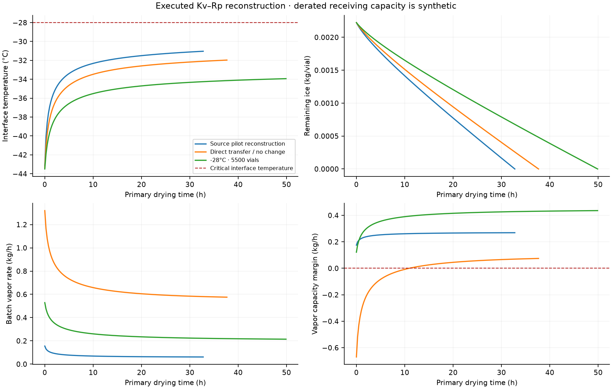
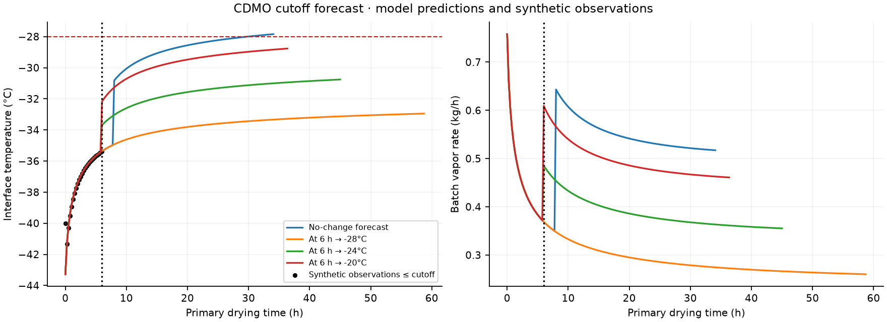
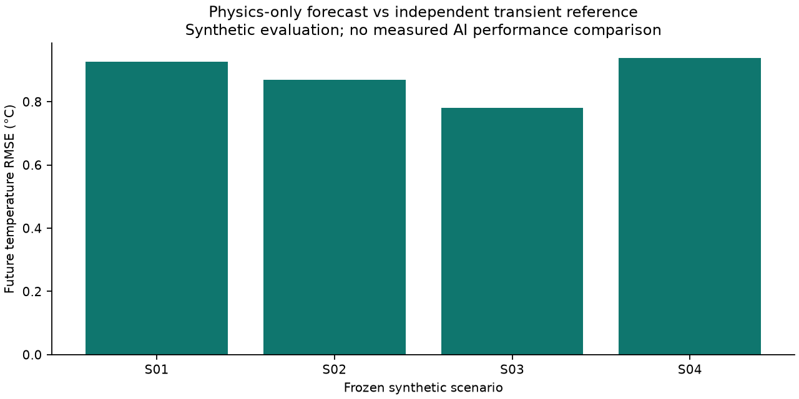

# Executed freeze-drying demonstration

Generated by `PYTHONPATH=backend .venv/bin/python -m src.lifesci.lyophilization.demo`. All numbers below come from the saved calculation records.

## Scientific source and reproducibility

[Vanbillemont et al. (2025)](https://doi.org/10.1186/s41120-025-00115-5) supports a mechanistic reconstruction. Its raw experimental datasets are not publicly available; the supplement contains cake images only. No independent experimental trajectory or numerical digitization is available. Prediction error below is against a synthetic reference, never experimental validation. See [source inventory](../../research/freeze-drying-sources.md).

Published: formulation, vial geometry, Kv/Rp regressions, critical temperature and pilot/commercial operating summaries. Reconstructed: constant latent heat/ice conductivity, quasi-steady Fourier frozen-layer conduction, idealized schedules, lognormal variability, receiving derating, ice storage, utilities and synthetic CDMO sensors. Every numerical input is classified with units in the simulation record. No new experimentally estimated or digitized inputs were produced.

The source has an omitted exponential in its vapor-pressure equation and a conflicting pilot choked-flow slope. The implementation uses Murphy–Koop exponential vapor pressure and a constant pilot deposition ceiling within the characterized pressure range. It does not silently repair the disputed slope. Commercial experimental transfer used one shelf; the 11,000-vial demonstration is a reconstructed full-load scenario.

## Technology transfer

| Candidate | Load | Completion h | Critical margin °C | Vapor margin kg/h | Nominally feasible |
|---|---:|---:|---:|---:|---|
| Source pilot reconstruction | 1028 | 32.76 | 3.03 | 0.175 | True |
| Direct transfer / no change | 11000 | 37.67 | 3.97 | -0.670 | False |
| -28°C · 11000 vials | 11000 | 49.89 | 5.94 | -0.407 | False |
| -32°C · 11000 vials | 11000 | 71.02 | 8.11 | -0.144 | False |
| -24°C · 5500 vials | 5500 | 37.67 | 3.97 | -0.010 | False |
| -28°C · 5500 vials | 5500 | 49.89 | 5.94 | 0.121 | True |
| -32°C · 5500 vials | 5500 | 71.02 | 8.11 | 0.253 | True |

Full loading on the derated receiving equipment violates the assumed vapor-handling ceiling. Such imposed-pressure trajectories are diagnostic extrapolations once capacity is exceeded. Bounded changes trade batch size and hold duration; selection maximizes nominal primary-drying throughput, excluding freezing, secondary drying and turnaround.

## CDMO operation

At the fixed 6 h evidence cutoff, a temperature-only fit evaluates three distinguishable explanations:

| Hypothesis | Estimated modifier | Temperature RMSE °C | Identifiable |
|---|---:|---:|---|
| changed_heat_transfer | 1.226 | 0.679 | True |
| changed_product_resistance | 1.394 | 0.657 | True |
| reduced_vapor_capacity | withheld | 1.074 | False |

Heat transfer and resistance compensate in early temperature data. Reduced vapor capacity is unidentifiable with prescribed pressure and is not ruled out. Pair gravimetric batch mass loss with center/edge thermometry and independent pressure-control characterization. Changes begin at the cutoff; prior thermal excursions block a rescue recommendation.

## Frozen comparison results

Protocol and hidden targets were written and hashed before reference and agent execution. Both AI arms use the existing PrimeInvestigationAdapter, the same visible packet and model route, 32 tool calls, 120 s and a $1 reservation. Existing evidence, historical comparisons, analytics and Python calculations remain available; A may write its own numerical simulator. B additionally receives registered process-model adapters. No completed agent response is replaced with a canned result.

| Scenario | Physics temp RMSE °C | Coverage | Completion absolute error h | Thermal detection | Vapor detection | Reference intervention feasible | A | B |
|---|---:|---:|---:|---|---|---|---|---|
| S01 | 0.928 | 0.96 | 1.16 | TN | FN | False | unresolved | unresolved |
| S02 | 0.869 | 1.00 | 5.82 | TP | FN | False | unresolved | unresolved |
| S03 | 0.780 | 0.93 | 2.08 | TP | FN | False | unresolved | unresolved |
| S04 | 0.938 | 0.96 | 1.24 | TN | FN | False | unresolved | unresolved |

TP/FP/FN/TN are evaluated separately for temperature and vapor constraints. The reference has finite heat capacity, two vial populations and pressure response; the tool is quasi-steady and represents one vial. Shared constitutive laws remain a limitation. Forecast error uses overlapping active-primary-drying times only; coverage is reported to expose endpoint censoring. Thermal detection compares the representative-vial prediction with the hottest active reference population.

### Agent attempts and resource measurements

- S01 / A: `unresolved`, 0.0007 s adapter runtime. no qualified, available model for investigation_planning (floor M3); record an evaluation before enabling this route
- S01 / B: `unresolved`, 0.0004 s adapter runtime. no qualified, available model for investigation_planning (floor M3); record an evaluation before enabling this route
- S02 / A: `unresolved`, 0.0006 s adapter runtime. no qualified, available model for investigation_planning (floor M3); record an evaluation before enabling this route
- S02 / B: `unresolved`, 0.0004 s adapter runtime. no qualified, available model for investigation_planning (floor M3); record an evaluation before enabling this route
- S03 / A: `unresolved`, 0.0006 s adapter runtime. no qualified, available model for investigation_planning (floor M3); record an evaluation before enabling this route
- S03 / B: `unresolved`, 0.0004 s adapter runtime. no qualified, available model for investigation_planning (floor M3); record an evaluation before enabling this route
- S04 / A: `unresolved`, 0.0007 s adapter runtime. no qualified, available model for investigation_planning (floor M3); record an evaluation before enabling this route
- S04 / B: `unresolved`, 0.0004 s adapter runtime. no qualified, available model for investigation_planning (floor M3); record an evaluation before enabling this route

No route was automatically qualified to obtain a response. Unavailable runs have null AI scientific scores and no measured AI uplift. Persisted gateway records retain status, issues, configuration and actual spend; zero spend for a routing rejection is not a measured successful inference cost. Human review effort is unavailable. Existing deterministic concern analytics were executed separately and saved; they are not described as AI performance.

### Warning timing and intervention checks

- S01: lead times (h): thermal=None, vapor=None; intervention={"completion_difference_h": 0.0, "feasible_in_reference": false, "reference_capacity_onset_h": 0.0, "reference_completion_h": 31.75, "reference_critical_onset_h": null, "selected": "No-change forecast"}. Physics runtime 1.27 s; inference cost $0.
- S02: lead times (h): thermal=18.0, vapor=None; intervention={"completion_difference_h": 1.5, "feasible_in_reference": false, "reference_capacity_onset_h": 0.0, "reference_completion_h": 29.75, "reference_critical_onset_h": null, "selected": "At 6 h \u2192 -20\u00b0C"}. Physics runtime 1.47 s; inference cost $0.
- S03: lead times (h): thermal=14.75, vapor=None; intervention={"completion_difference_h": 2.25, "feasible_in_reference": false, "reference_capacity_onset_h": 0.0, "reference_completion_h": 38.0, "reference_critical_onset_h": null, "selected": "At 6 h \u2192 -20\u00b0C"}. Physics runtime 1.26 s; inference cost $0.
- S04: lead times (h): thermal=None, vapor=None; intervention={"completion_difference_h": 0.0, "feasible_in_reference": false, "reference_capacity_onset_h": 0.0, "reference_completion_h": 31.75, "reference_critical_onset_h": null, "selected": "No-change forecast"}. Physics runtime 1.08 s; inference cost $0.

## Limitations and next experiments

This is an unqualified engineering demonstration. It predicts neither final residual moisture, potency, release suitability, energy nor commercial yield. Monte Carlo frequencies are conditional outcomes under assumed distributions, not calibrated real-world risks. Eight or sixteen samples cannot estimate rare failures. Full commercial-scale experimental transfer, facility utilities and vapor capacity require characterization. The operations estimator is conditional replay with fixed fitted parameters, not validated online state estimation. Ambiguous explanations and structurally missing capacity dynamics can produce missed warnings and infeasible recommendations in the independent reference; these failures are preserved.

Next: obtain raw pilot/commercial traces and exact loads; resolve the pilot slope with authors; characterize edge/center Kv, product-specific Rp and capacity; pre-register an independent holdout; execute the instrumented verification plan with assigned MSAT and QA reviewers. Temperature <−28°C, pressure-control headroom, independently verified endpoint and prespecified engineering error tolerances require reviewer approval. Final product testing remains separate.

## Detailed article outline

1. **Published context:** primary drying physics and the authors’ pilot-to-commercial case, with exact scope of experimental verification.
2. **Published evidence boundary:** acquisition, unavailable raw data, supplement contents, parameter transcription, source equation/conflict handling and LyoPRONTO licensing.
3. **Our implemented reconstruction:** SI balances, solver/event handling, frozen-layer conduction approximation, schedules, applicability limits and provenance records.
4. **Our measured transfer calculation:** direct transfer, receiving derating, bounded loading/temperature comparison, throughput trade-offs, sampling intervals and proposed verification.
5. **Our measured CDMO calculation:** evidence cutoff, ambiguous Kv/Rp fits, capacity non-identifiability, no-change and intervention trajectories, no rescue claim.
6. **Our measured comparison:** frozen protocol, independent synthetic reference, executed existing-agent attempts, unavailable AI scores, false alarms/misses, lead times and intervention failures.
7. **Our integration evidence:** authenticated API, permission checks, reviewed proposals, source revisions, invalidation, tests and browser checks; no production qualification claim.
8. **Future hypotheses:** calibrated early warnings, improved transfer efficiency and reduced review effort; each needs prospective measurement rather than inference from this demo.
9. **Next experiments and acceptance:** obtain holdouts, characterize equipment/formulation, assign reviewers and evaluate endpoint, thermal margins and final product separately.
