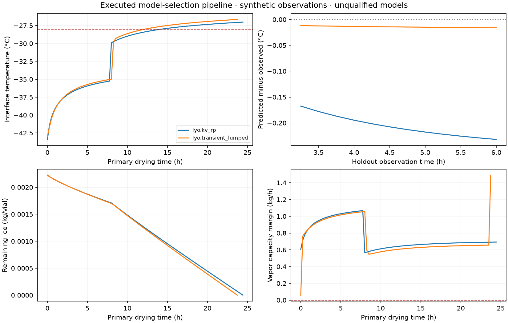

# Executed physical model-selection pipeline

Plan authored by **person**. Actual agent planning: **agent_unavailable**; actual agent result assessment: **agent_unavailable**.

No agent selection or assessment was fabricated when the existing model route was unavailable. The engineer-authored example uses the same typed plan and numerical runner available to the agent tools.

| Physical model | Status | Training Kv scale | Holdout RMSE °C | Holdout coverage | Completion h |
|---|---|---:|---:|---:|---:|
| lyo.kv_rp | completed | 1.167 | 0.207 | 1.00 | 24.44 |
| lyo.transient_lumped | completed | 1.256 | 0.014 | 1.00 | 23.74 |

Resource use: 26 solver calls, 1.19 s. Seed: 2025.

Training uses observations through 3 h. Holdout observations are later than 3 h and available by 6 h. Earlier full-window diagnostic fits are discarded. Holdout scoring uses observed operating history; prospective interventions are not graded as executed measurements. All observations in this example are synthetic, not independent experimental validation.

The transient model adds a lumped thermal state and requires assumed vial heat capacity (3 J/K) and initial temperature (−43°C); constant ice specific heat is approximated as 2100 J/(kg K). These inputs require characterization. Greater complexity or lower synthetic holdout error does not qualify a model.

The live 3D review uses saved diameter/fill geometry and executed ice-front/temperature states. Glass body height and shelf are schematic. Color represents one interface temperature, not a resolved 3D temperature or flow field. The geometry frames, solver versions, parameter snapshots, training/holdout rows, random seed, model code hashes and runner hashes are retained in analysis.json and plan.json.

Engineering review proposal: prop_01M5X2MYBAMV43S5YYEG97KSTD; state proposed; execution not_started. No manufacturing change or scientific qualification was applied.

New models can be proposed through the adapter review tool/API. Proposals retain equations, required inputs and units, source/license information, intended-use limits and a verification/independent-validation plan. They neither register models nor execute generated code.

Reproduce: `PYTHONPATH=backend .venv/bin/python -m src.lifesci.process_engineering.demo`.

See [workflow and integration guide](../model-selection.md) for API/tool contracts, UI usage, testing and limitations.
