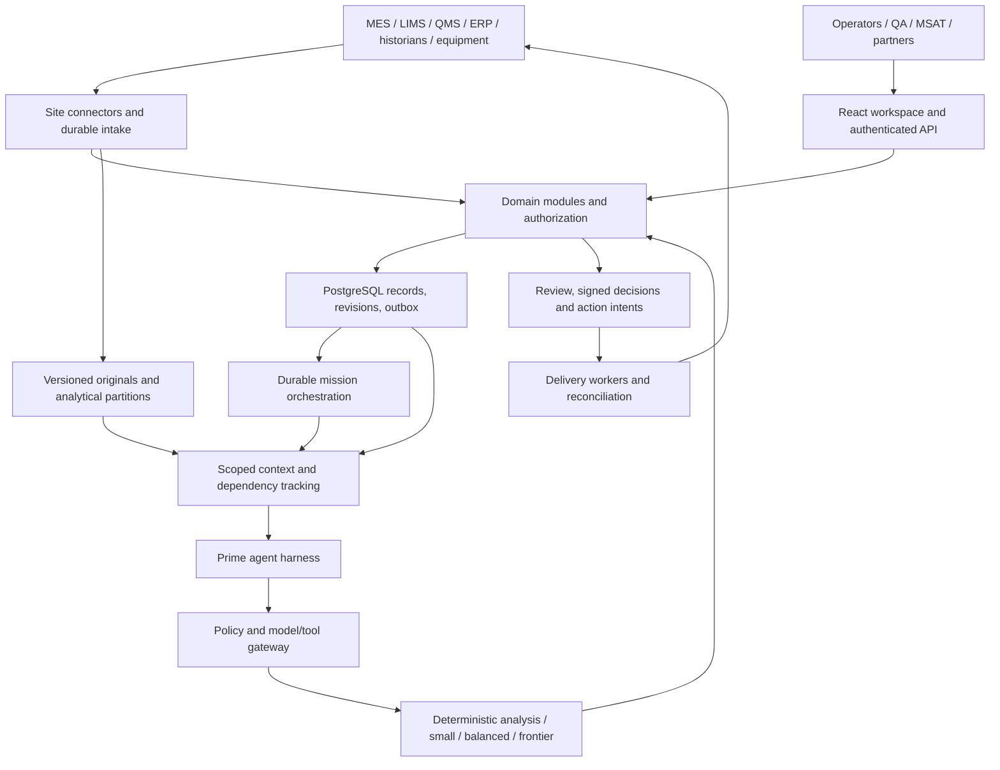

# Architecture

Recommended implementation design, 2026-10-23. Decisions are indexed in the [decision log](decision-log.md); capability status is in the [checklist](capability-checklist.md). Technical sources A01–A10 are collected in the [primary-source note](../../research/life-sciences-architecture-sources.md); direct links below support specific component facts.

## Job, boundaries and deployment shape

Manufacturing, laboratory, quality, engineering, MSAT and partner teams need connected work with inspectable evidence and clear authority. A persistent mission can span a batch, equipment concern, campaign or transfer; it may contain several cases and tasks. A UI role does not require a separate permanently running agent. The same domain services serve guided execution, tables/charts, contextual assistance, notifications, review and automation.

Choose a modular FastAPI application for transactional domain operations, plus separately scalable intake, analysis, agent and delivery workers. This keeps cross-domain transactions understandable while separating expensive work. Split a module into an independent service when measured deployment, security or scaling needs justify it. Do not require a fleet of microservices at launch.

## Domain modules

### CORE — Identity, authority, shared context

Own tenant, organization, site, project, person/service identity, role assignments, memberships and partner grants. Every domain aggregate carries tenant and applicable site/project scope; external object references include system and revision. Permissions combine role and resource/scope attributes and are checked at request, retrieval, task execution and output. A valid login is not authorization to every batch.

Use verified enterprise identity federation through an adapter; extend existing OIDC verification. Add non-owner PostgreSQL runtime roles and RLS to applicable tables, with transaction-local tenant context and pool reset tests. Service jobs carry limited delegated scope and recheck current grants. Privileged maintenance operations use separately audited identities. PostgreSQL documents owner and BYPASSRLS exceptions; RLS supplements application controls rather than repairing an overprivileged database identity. [PostgreSQL RLS](https://www.postgresql.org/docs/current/ddl-rowsecurity.html)

Keep an explicit record-ownership registry for each capability/site: external authoritative system, local projection, or enabled native module. Define conflict resolution and write permissions before turning on bidirectional synchronization.

### INT — Integrations and evidence intake

Reuse generic REST/JSONL and file ingestion behind versioned adapters. Add durable HTTP webhook intake, polling cursors, change feeds and site collectors as needed. Supported integrations are a matrix of source/version/auth/schema/operations, not a logo list. Initial ingestion is read-authorized; configured routing and approved writes use separate credentials and interfaces.

A site collector can buffer during WAN outages, preserve source sequence/quality/timestamps, encrypt its spool, and backfill after reconnect. OPC UA or MQTT is a transport option with explicit semantics. Do not expose PLC write operations to the general agent. Control-system interlocks and deterministic real-time control stay with the designated equipment systems.

Persist original object content, its digest and source reference before publishing a usable evidence revision. Track staging/committed states so partial object/metadata writes are reconcilable. Normalize units and identities through recorded transformations; retain unresolved mappings. Store sample/event time separately from first-seen/recorded time. Handle duplicate IDs, revisions, deletions, schema drift and late data explicitly.

Keep high-frequency telemetry in the historian/columnar partitions; create bounded windows and meaningful change events for reasoning. An LLM call per sensor reading is neither required nor efficient. OPC UA retransmission and durable-subscription capabilities depend on server support; detect sequence gaps and backfill. [OPC UA subscriptions](https://reference.opcfoundation.org/Core/Part4/v105/docs/5.14)

### PROC — Controlled procedures, recipes and instructions

Represent original controlled documents, revisions, effective scope/date, authority, extracted sections, typed steps, branching/parallel dependencies, parameters, units, limits and completion evidence. Reuse document revision primitives. Existing clear applicable SOPs can guide authorized work directly. A supplied procedure map is an alternate representation with provenance, not a higher authority.

Agent extraction produces an inspectable structured interpretation with source spans. Native executable recipe publication follows the organization's review/change-control policy. Pin an execution instance to an approved revision; a mid-run change creates a revision/change request and checks effects on completed/pending steps. Preserve redlines, N/A reasons, review and execution history. Never silently replace the active recipe because an agent found a newer document.

The authoring interface supports familiar forms/graph editing, reusable parameterized templates, previews and rule validation. It must accommodate modality-specific structures without requiring users to create a map before beginning useful analysis.

### EXEC — Production, resources and execution

Represent production orders, batches, material lots, equipment, resource status, recipe instances, step observations, holds and completion. Begin by projecting external MES/ERP state and coordinating work. An optional native execution adapter supports typed step execution, calculations, material checks, required evidence and authorized signatures; it requires its own intended-use qualification before live operation.

Model clinical flexibility, commercial repeatability and site-specific variants as explicit policies and revisions. Distinguish a proposed parameter adjustment, an approved change and equipment-confirmed execution. Never infer batch release from a complete agent report. Track equipment qualification/maintenance and material expiry/availability through the authoritative source. Cell-therapy identity/custody and individualized batches need explicit traceability fields and separate acceptance scenarios.

### LAB — Samples and laboratory execution

Own or project sample identifiers, collection events, custody transfers, aliquots/plate positions, methods/revisions, instrument references, results, calculations and review. Link samples to batch/process step and availability time. Preserve raw instrument data, units, method limits and correction history. Existing LIMS/LES remains authoritative unless the native module is specifically enabled.

A native method execution instance uses the shared procedure engine with laboratory rules, instrument readiness checks and method-specific calculations. Distinguish calculation validation, analytical validity, and qualified scientific review. A retry must not create a duplicate sample or overwrite a released result. Global method distribution preserves site adaptations and approvals.

For initially supported native execution, loss of authoritative connectivity is visible and pauses dependent steps/signatures under the site's approved continuity procedure. Browser drafts and offline observations are explicitly provisional and cannot authorize subsequent steps. True offline execution is a later qualified edge protocol with pinned procedures, locally enforced authority, signed ordered events and tested reconciliation; it is not implied by mobile access or intake buffering.

### QUAL — Quality, investigation, review and follow-up

Extend existing findings, hypothesis, evidence request, review and outcome primitives. Distinguish signal, deviation case, investigation interpretation, approved finding, CAPA proposal/action, effectiveness evidence and authorized closure. Required notification follows configured timing independently of completed analysis.

Produce versioned editable forms and packages with field-level evidence, unresolved fields and clear observation/calculation/hypothesis/decision labels. Reviewer corrections invalidate dependent claims/fields and relevant approvals. Reuse of a prior investigation requires the agreed owner summary, similarities/differences and proposed reuse approval before acceleration. A QA review and an operational action authorization are distinct objects.

Support review by exception with explicit coverage of checked and unchecked items. An empty exception list is not evidence of a fully reviewed batch. Link to QMS records and reconcile submissions; system-of-record closure remains authoritative where assigned.

### SCI — Scientific data, models and improvement

Retain Polars/DuckDB/Parquet and deterministic analysis tools. Version each computation by inputs, code, parameters, units, availability cutoff and output. Provide reusable modules for trends/control charts, batch comparison, yield calculations, equipment/OEE, curve fitting, chromatography, qPCR/assays and designed experiments. Each domain-specific method needs appropriate test fixtures and scientific review; a generic chart is not parity with the analysis.

Store statistical/predictive model identity, training provenance, allowed process domain, calibration/validation evidence and drift status. The agent can plan comparisons and invoke tools; numerical results and constraints come from reproducible computations. Optimize objectives subject to quality/process constraints; record uncertainty, alternatives, expected benefit basis and intervention authority. Historical correlation does not establish causal improvement.

Treat proposed experiments, simulated outcomes and observed results separately. Begin with supported deterministic methods; add optimization or digital-twin modules when data and validity justify them. Background preparation is scoped and budgeted. Index approved lessons separately from unreviewed agent memories.

### NET — Sites, partners and technology transfer

Use shared context for product/process definitions with scoped site variants and external-reference mappings. A transfer package contains versioned procedures, parameters, material/equipment mappings, required qualifications, open gaps and approvals. Recipient review validates local feasibility; transmitting files is not completing tech transfer.

Partner grants are explicit, expiring and revocable per resource/action. Share permitted evidence projections rather than an entire tenant's memory. Preserve the origin of sponsor feedback and site corrections. Provide campaign readiness, capacity/resource constraints, inventory risks and site comparison views using sourced data. Avoid a cross-region strongly consistent global database at launch; assign an owning region/site for writes and publish authorized projections.

### COLLAB — Handoffs, notifications and remote assistance

Provide task ownership, comments, evidence requests, acknowledgment, escalation and scheduled shift summaries across the same work records. Delivery adapters cover enterprise email/chat first; SMS/other channels require organization-approved configuration. Store intended recipient/payload version, provider receipt, attempts and final or unknown delivery outcome.

For video assistance, integrate an established enterprise media service behind an adapter; build session permissions, consent, case links and optional reviewed transcripts/annotations. Wearable/AR drawing and hands-free interaction are explicit device-dependent modules, not implied by a responsive webpage. Record device/browser support and test procedure usability in real work conditions.

### ASSURE — Records, signatures, qualification and operations

Record identity, timestamp, meaning and exact record version for signatures; bind the signature to the approved content and authenticate the signing action through appropriate controls. Audit record changes with actor, reason and before/after references while protecting sensitive content. Protect retention and exports independently of application logs. A hash or audit trigger alone does not prove compliance. [21 CFR Part 11](https://www.ecfr.gov/current/title-21/chapter-I/subchapter-A/part-11)

Provide versioned intended-use requirements, risk assessments, traceable test evidence, configuration manifests, training/support records, backup/restore evidence and change impact review. Customer qualification includes process, integrations and operating procedures. Do not promise a certification or a rollout duration because a competitor advertises one. Original data, metadata and reviewability inform the design. [FDA data-integrity guidance](https://www.fda.gov/regulatory-information/search-fda-guidance-documents/data-integrity-and-compliance-drug-cgmp-questions-and-answers)

## AGENT — Persistent missions and adaptive reasoning

Mission state: objective, scope, owner, constraints, subscriptions, current plan/version, unresolved obligations, budgets, pending decisions, last processed event sequence and active/cancelled/archived status. Context state: relevant current evidence versions, hypotheses and contradictions, approved/rejected proposals, upcoming deadlines and links to full history. Individual model runs and sandboxes can end without ending a mission.

Use Temporal for mission wakeups, durable waits/timers and bounded activity coordination. Run model/tool I/O in activities; workflow code must remain replay-compatible. Persist session/artifact checkpoints outside workers. Temporal history contains minimal references, not full sensitive evidence or an unbounded sensor log. Continue/roll over histories using the engine's supported mechanism and preserve mission identity across runs. Maintain explicit workflow versioning for in-flight upgrades. The exact orchestration dependency belongs behind a mission scheduler port.

This selects a production target because the user explicitly requires ongoing work, new-event resumption and long human/evidence waits. It supersedes the earlier provisional engine comparison. Before enabling it, assign platform-operations ownership, an approved deployment region, backup/restore and in-flight versioning tests; existing fenced jobs continue serving bounded activities rather than becoming a competing mission scheduler. If deployment eligibility fails, use the recorded D09 alternative and demonstrate the same semantics.

Prime remains the initial reasoning runtime because it is already integrated with scoped tools and report checks. Give it a domain-neutral task envelope and persist sessions/artifacts in durable storage. Use the existing finite-run budgets per activation; do not extend a subprocess indefinitely. A lead can delegate independent tasks with immutable input snapshots, bounded budgets and named deliverables. Role-specific skills and tool scopes usually suffice without a separate always-on agent per persona.

On new evidence: commit revision → identify dependents → mark stale → schedule affected work → assemble scoped context → reason/calculate → validate proposal → publish revision and changed status. Recompute asynchronously, but validate the current input manifest/revision at read, commit and dispatch boundaries so delayed invalidation cannot present an outdated proposal as executable. Mark affected queued intents cancelled or awaiting reassessment. New results cannot silently preserve approval of changed content. Outputs include basis versions; acceptance uses optimistic concurrency and rejects/rebases stale work.

Memory consolidation writes derived summaries with evidence pointers and status. Preserve original recoverable history, corrections and rejected hypotheses. An agent-editable memory must not override a controlled procedure or current permissions. Model upgrades reuse task/evidence artifacts and rerun evaluations; they do not assume identical hidden context formats. [Managed session/harness separation](https://www.anthropic.com/research/managed-agents), [recoverable context](https://www.langchain.com/blog/context-engineering-deep-agents-remember)

Derived summaries, embeddings, cached outputs and shared artifacts inherit restrictions from all contributing inputs. Access requires authorization for those dependencies; a revoked input quarantines the affected derived content until a permitted version is regenerated. Rechecking only the caller's top-level role is insufficient. If transformation lineage is incomplete, treat the artifact as unavailable for sharing rather than assuming a redacted summary is safe.

## Data ownership and consistency

PostgreSQL owns BioDemo domain aggregates, revisions, grants, decisions, action intents, work queue projections and transactional outbox. Versioned object storage owns original bytes, large derived artifacts and session checkpoints. Parquet/analytical stores own derived read workloads; search/vector indexes are rebuildable projections. Existing external systems own assigned official records. Temporal owns execution progress. No two components independently own the same domain decision.

Every command has request/idempotency key, actor/delegation, tenant/site, aggregate ID, expected revision, purpose and payload reference. Every event has event ID, type/schema version, aggregate/version, tenant/scope, event and recorded time, causation/correlation IDs, source revision and minimal payload or artifact reference.

Commit aggregate update, audit reference and outbox event in one PostgreSQL transaction. Publish with at-least-once delivery; consumers use inbox/dedup keys and process aggregate versions. Enforce unique action intents and operation identity at destinations where supported. Unknown external outcomes enter reconciliation; do not retry consequential writes blindly. Do not promise global exactly-once effects.

Temporal schedules work and retains execution progress; it does not write a competing authoritative mission assessment. Activities submit domain commands with expected revisions and stable command IDs. The domain transaction publishes resulting events back to orchestration through the outbox; a crash between these steps is replayable and deduplicated. A per-mission lease/fencing token prevents obsolete workers from committing after replacement. Parallel specialists submit versioned findings for explicit merge; concurrent edits cannot silently overwrite facts, permissions or human decisions.

Admit one coordinator activation per mission revision. Coalesce pending wakeups without dropping their event IDs; a newly committed revision can cancel or supersede an obsolete activation. Store worker checkpoints under immutable attempt/version keys and promote the current checkpoint through the fenced domain commit, so an old process cannot overwrite a newer resume pointer. Child findings merge through the active coordinator against their explicit input manifests.

Before dispatch, atomically validate intent status, current authority, approval/content binding and relevant evidence revisions, then claim the operation with a fencing token. Use conditional target-version updates where the destination supports them. A newly arrived event cannot undo an already transmitted external operation; record its actual outcome and trigger the site's correction/review process when necessary. Do not claim that distributed checks eliminate every in-flight race.

Store original→extraction→mapping→calculation→claim→form field→recommendation→approval→execution→outcome dependencies as indexed relational edges. This enables targeted invalidation and inspection. A separate graph database is optional after measured query pressure; multiple stores now would add synchronization burden.

## Interface contracts

| Contract | Required output / behavior |
| --- | --- |
| `ingest(source, cursor, scope)` | Immutable evidence refs, next cursor, gaps, source version, idempotent acknowledgment. |
| `resolve_procedure(context, as_of)` | Applicable authorized revisions, section refs, conflicts and unresolved applicability; never permission escalation. |
| `start_or_resume_mission(objective, scope, revision)` | Durable mission ID, status, pending work and observable event stream. |
| `assemble_context(mission, snapshot, actor)` | Authorized evidence manifest, current goals/constraints, changes, unresolved work, history references, token budget. |
| `run_task(task, context, route_policy)` | Structured result, source refs, unresolved issues, model/tool/version/usage, checkpoint, proposed next work. |
| `propose_action(target, payload, basis)` | Versioned proposal, required authority and decision state; no external side effect. |
| `authorize(proposal, actor, expected_revision)` | Decision bound to exact scope/payload/basis, signature where required, expiry/reassessment rules. |
| `deliver(intent)` | Target receipt/version, completed/failed/unknown state, reconciliation plan. |
| `record_outcome(action, observations)` | Observed result and attribution limitations, separate from expected effect. |

Streaming UI events carry sequence/cursor and snapshots to recover missed updates. The client renders server state; browser storage holds recoverable drafts, never the sole shared work record. Source viewers and scientific tools remain available alongside agent conversation.

## Speed and scale

Use independently autoscaled intake/I/O, CPU analysis, model-bound reasoning and delivery pools. Partition work by tenant/site/aggregate where ordering matters; apply weighted fairness, concurrency quotas, queue aging and separate urgent notification capacity. Long analysis must not block an operational alert or review command. Coalesce redundant wakeups while retaining all evidence revisions.

Keep transaction paths short; return accepted-job IDs for lengthy work. Cache versioned deterministic computations and retrieval results with scope/policy/version keys. Push column selection, time windows and aggregation into analytical tools. Avoid shipping full historian traces to a model. Stream early supported findings and expose incomplete work.

Start with the repository's AWS-compatible object/job infrastructure and managed PostgreSQL, with Temporal available in the approved region/deployment boundary. Container workers extend existing cloud isolation; separate domain credentials from generated-code sandboxes and restrict egress. A private installation can use equivalent services under the same contracts. No GPU cluster is required for API-backed models.

Scale PostgreSQL with appropriate indexes, partitioned evidence metadata, read replicas for eligible non-authoritative reads and query budgets. Separate analytics before sharding transactions. Introduce a dedicated event broker if measured fan-out/retention/throughput exceeds the outbox dispatch design; Kafka is an expansion option, not a prerequisite. Preserve causal versions across any broker migration.

Instrument queue age, source lag, recomputation lag, p50/p95 latency, memory invalidations, tool/model cost, retrieval quality, reviewer corrections, notification outcomes and tenant resource usage. Audit trails and operational telemetry have separate retention/access policies. Avoid sensitive prompts in shared traces. [Evaluation and workload plan](delivery-and-verification.md) defines the measurements and release gates.

## Four-pillar trade-offs

| Pillar | Choice | Cost / measure |
| --- | --- | --- |
| Easy to Start | Authorized source discovery, reusable mappings, partial results | Connector setup remains real work; measure preparation and first useful result. |
| Easy to Trust | Versioned evidence, typed claims, correction dependencies, authority checks | Storage and review overhead; measure source fidelity, stale advice and correction effort. |
| Easy to Act | Persistent missions, editable proposals, routed decisions and observed outcomes | More durable state; measure completed handoffs and useful actions rather than report count. |
| Easy to Adopt | External record ownership, modular native capabilities, familiar role surfaces | Some integration latency and customer configuration; measure adoption and maintenance burden. |

This is the recommended fit for the known code and requirements. Customer scale, infrastructure restrictions, instruments and procedure semantics still determine configuration and qualification; no universal performance optimum is established by the design alone.
