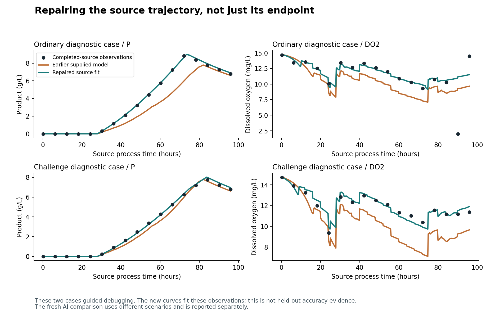

# What was wrong with the physics treatment

The earlier experiment did not isolate the value of a well-configured physics model. Its physics treatment included inappropriate calibration reuse, an omitted production-kinetics fit, and ambiguous source/receiving plan presentation. These were implementation/design choices in this benchmark, not evidence that physics is inherently harmful. Conversely, correcting them does not guarantee the AI will improve or establish that these simulators predict real manufacturing.

A later source-admission audit found another benchmark defect:9/48 sources in the first repair dataset had oxygen-floor events, although their receiving KEEP plans passed. That partial AI run was stopped and retained before comparative scores were inspected. Source-domain admission and a declared source aeration schedule exposed one further case before replacement inference. A minimal replay showed the solver's1.9922505097mg/L value being overwritten with1mg/L. The final correction preserves nonnegative continuous ODE oxygen consistently in source, evaluator, tool and fit. See the [source-admission correction](model-repair-source-admission-20261028.md) and [continuous-oxygen correction](model-repair-continuous-oxygen-20261028.md). This removes a numerical reset; it does not establish experimental validity of the oxygen balance.

The decision to reuse the first prior batch's calibration across every challenge was ours. It was documented and followed the earlier request to defer model updates, but it was not an appropriate default for testing a correctly calibrated model across varying situations. The user has now authorized repairs. Earlier results remain the results of those earlier configurations.

## Reproduced findings

| Finding | Evidence | Correction or unresolved limit |
|---|---|---|
| SMPL initialization correction applied twice | Original raw ODE matched the same-model target; the wrapper then added a roughly2% product correction and617million cells/L from an older initialization mismatch. All144 old SMPL task packets replayed exactly under legacy semantics; corrected wrapper maximum relative discrepancy was near numerical precision. | Remove obsolete output bias when the complete observed initial state is actually used. Verify all17 components and retain legacy replay. |
| PenSim calibration belonged to a different batch | Across48 previous cases the nominal path already missed observed60h product by33.4% on average, oxygen by12.9%, and substrate by44.2%. | Fit only the completed current source; check source-history hash and source operating plan before execution. |
| Oxygen/substrate calibration omitted product trajectory | On a diagnostic challenge, refitting the old two factors still missed source product by34.2% during36–72h despite exactly matching its96h endpoint. Product endpoint scaling cannot repair the trajectory's timing. | Estimate the existing production kinetic factor inside the coupled ODE along with growth andkLa, fitting P/DO/S at multiple times. No endpoint multiplier or DO offset. |
| Agents used a poor tool differently by task | PenSim B copied all six model forecasts closely in85/96 outcome sessions and93/96 transfer sessions, versus4/95 prediction sessions. Its forecast-only reasoning often compensated for a poor tool. | Report tool quality separately from AI quality. Supply action-specific forecast labels and source/receiving plan context to both arms. Do not force B to copy model outputs. |
| Source and receiving plans were conflated | Submitted SMPL rationales sometimes treated the completed source as having used receiving KEEP commands. In fact source used flow1/nutrient1, while receiving schedules differed. | Explicit separate plans in common packets; same clarification to both arms. |
| Positive raw oxygen was overwritten between integration steps | In source9014 at80.2h, raw1.9922505097mg/L became1mg/L, feeding the changed state into the next interval. | Versioned adapter preserves the raw value, rejects negative/nonfinite oxygen, and records prevented resets. Independent96h solver agreement passes; the2mg/L operating constraint is still enforced. |
| Full230h PenSim viscosity becomes negative | Tighter native integration and independent Python integration reproduce a negative viscosity state. At zero viscosity the empirical water-addition term can still make its derivative negative. | Retain rejection and failed trajectory. No guessed rheology replacement or clipping is presented as validated.96h is a partial-process test only. |

Clock/score reconstruction did not explain the primary forecast regression: prediction tasks allow only KEEP, and actual targets are exact KEEP trajectory values at declared times. SMPL kinetics and flows are per minute; integration converts hours to minutes. Independent combined reactor/separator product-inventory tests verify internal flows cancel and external harvest is counted once. These checks do not establish independent empirical accuracy. The upstream heat-balance assumptions and fixed geometry remain model limitations.

The previous decision-score gains mostly reflected fewer infeasible plans, abstention errors and execution failures. Conditional on both agents choosing feasible plans, mean product differences were around2.2% for PenSim and0.6% for SMPL; those selected subsets are descriptive, not general production gains. An8-point decision-score gain is not8% more manufactured product.

## Correction evidence and scope

The plot shows the two development cases used for calibration diagnosis, before the later continuous-oxygen correction. The new curves fit these source observations; they are not held-out predictions. The oxygen outliers in the ordinary case remain visible: the constant-parameter nominal model does not recover the unknown disturbance stream. The final study uses separately generated trajectories and the corrected oxygen adapter.

The new driver gives exactly the old trajectory with identical nominal parameters. Changing production kinetics affects product, substrate and oxygen together. A known-parameter synthetic test recovers the deliberately altered factors and predicts later source times withheld from fitting. The prior diagnostic source-shape failure falls from34.2% maximum relative error to6.6%; the ordinary diagnostic case is below2%. On these two already inspected cases, receiver forecast error changes from36.5% to2.1% and19.6% to4.0% of source scale. These are debugging checks, not independent generalization estimates.

The initial repair protocol used seeds8001–8048 and was stopped for the source-admission defect described above. The replacement uses9001–9048,48 situations per process, three tasks and two AI repetitions per arm. Bounds/algorithm and analysis are frozen before inference. See [repair protocol](model-repair-protocol-20261028.md) and its source-admission addendum. Parameters are fitted only to completed source evidence available to both agents; neither actual receiving outcomes nor hidden seeds enter fitting. Unknown future disturbances and latent morphology remain unmodeled, so errors can persist. We do not silently assimilate partial measured state into an inconsistent full33-state vector.

The full230h replay with the continuous-oxygen correction still rejects negative viscosity at148.6h. The oxygen fix does not resolve that separate empirical-law defect.

The earlier real CHO-K1 test uses a separate batch Monod/glucose model, not SMPL's continuous process. Its negative findings are not erased by this simulator correction. The glucose equation, declared units, positivity and a closed growth/substrate balance have tests, but omitted nutrients, stress and condition-dependent physiology still limit that simple model. No new real-CHO accuracy claim follows from these changes.

## Evidence and primary sources

- Earlier diagnostics: `backend/results/external-simulators/challenges-20261028/diagnosis/`, including `diagnosis.json`, `tool-adoption.json`, `PenSim-ablations.json`, and `contract-replay.json`.
- Repair checks: `backend/results/external-simulators/model-repair-20261028/diagnosis/`, including red/green source-shape receipts; old failed/superseded runs remain intact.
- [Pinned PenSimPy implementation](https://github.com/smpl-env/PenSimPy/tree/e08fc71fef193448f3ee9a304187dc92b88f3acc): parameter order, coupled P/S/O2 balances, control clock and empirical viscosity law inspected locally.
- [Original IndPenSim distribution by Stephen Goldrick](https://www.mathworks.com/matlabcentral/fileexchange/49041-industrial-scale-penicillin-simulationv2): establishes source/model lineage, not validation of our wrapper or every operating regime.
- [SMPL process documentation](https://smpl-env.github.io/smpl-document/mabenv.html) and [pinned implementation](https://github.com/Mohan-Zhang-u/smpl/tree/c816917eebfde59d525e325b56d16db07e499531): continuous upstream reactor/separator; code's minute-based parameter units and concentration/flow meanings inspected directly.
