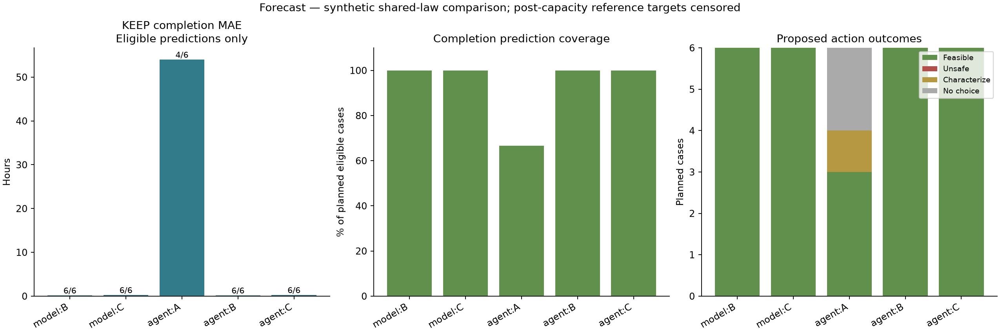
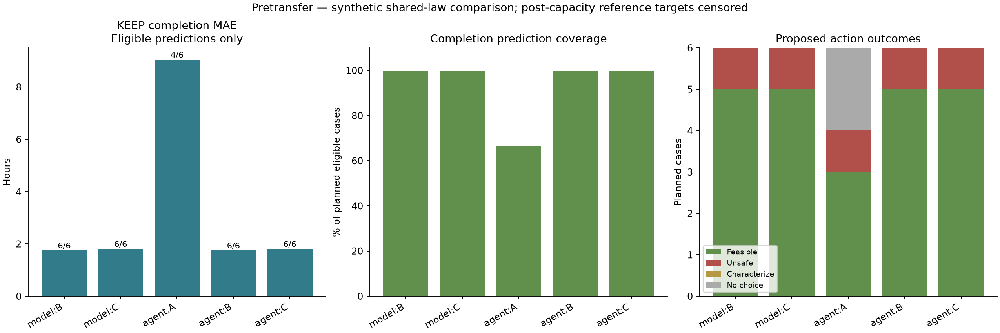

# Freeze-drying model and AI comparison

Exploratory synthetic comparison with shared constitutive physics. Reference completion and subsequent thermal outcomes are censored after equipment capacity exceedance. These are not plant measurements or plant validation.

Protocol scope: Post-hoc motivated, prospectively frozen same-case subset; joint budget and submission-policy change; not independent confirmation. Recorded completion policy: Final eighth provider turn exposes only submit_decision with forced function choice, identically across all three arms; earlier submission allowed; eight host calls include submission.

Forecast: population-minus-legacy completion MAE was +0.09 h on 6 common eligible predictions. AI results (A: 4/6 completed, 3 feasible / 0 unsafe selections; B: 6/6 completed, 6 feasible / 0 unsafe selections; C: 6/6 completed, 6 feasible / 0 unsafe selections).
Pretransfer: population-minus-legacy completion MAE was +0.06 h on 6 common eligible predictions. AI results (A: 4/6 completed, 3 feasible / 1 unsafe selections; B: 6/6 completed, 5 feasible / 1 unsafe selections; C: 6/6 completed, 5 feasible / 1 unsafe selections).

The study asks whether an explicit vial-population model and its availability to an AI agent change forecast errors and proposed operating choices. Forecast uses early synthetic receiving observations; pretransfer uses characterization without receiving observations. The tasks are reported separately.

A receives no prebuilt physical model; it can derive its own simulator using the shared Python tool. B uses the legacy representative-vial model. C uses the population thermal model. B and C use the same capacity applicability cutoff. Model-only B/C are deterministic selectors; AI A/B/C are recorded agent runs. These labels do not identify distinct underlying AI models.

Protocol: [frozen issue #1](https://github.com/YalmanchiliTejas/BioDemo/issues/1). Campaign status: **complete**. All submitted results are rescored from the frozen evaluator files; missing attempts and failed execution remain visible.

Recorded AI model: modal/zai-org/GLM-5.3. Per-attempt limits: 8 model calls, 8 tool calls, 240 seconds; output-token limit 4096.

## Forecast

Completion errors concern KEEP, regardless of the chosen action. MAE uses only eligible cases with a numerical prediction; coverage uses all planned eligible cases. Different coverage can change MAE, so the paired table below also uses common predictions.

| Arm | Planned | Attempted | Completed | Eligible | Predicted | Coverage | MAE (h) | Hindsight-invalid completions |
| --- | --- | --- | --- | --- | --- | --- | --- | --- |
| Model B (legacy) | 6 | 6 | 6 | 6 | 6 | 100.0% | 0.15 | 0 |
| Model C (population) | 6 | 6 | 6 | 6 | 6 | 100.0% | 0.25 | 0 |
| AI A (no prebuilt model) | 6 | 6 | 4 | 6 | 4 | 66.7% | 53.99 | 0 |
| AI B (legacy tool) | 6 | 6 | 6 | 6 | 6 | 100.0% | 0.16 | 0 |
| AI C (population tool) | 6 | 6 | 6 | 6 | 6 | 100.0% | 0.25 | 0 |

Hindsight-invalid means the hidden reference later exceeded capacity; it does not establish that the agent could know that from its public evidence.

### Thermal warnings

TP/TN are correct positive/negative calls; FP/FN are incorrect positive/negative calls. Abstain means a submitted unknown. Censored means the reference target cannot be evaluated. Execution failures and unattempted runs are separate. Truth counts include all planned cases regardless of execution. With zero truth positives, sensitivity cannot be estimated; small positive counts also limit interpretation.

| Arm | Attempted | Completed | TP | TN | FP | FN | Abstain | Censored | Failed | Not attempted | Truth positive | Truth negative | Truth unknown |
| --- | --- | --- | --- | --- | --- | --- | --- | --- | --- | --- | --- | --- | --- |
| Model B (legacy) | 6 | 6 | 1 | 5 | 0 | 0 | 0 | 0 | 0 | 0 | 1 | 5 | 0 |
| Model C (population) | 6 | 6 | 1 | 4 | 1 | 0 | 0 | 0 | 0 | 0 | 1 | 5 | 0 |
| AI A (no prebuilt model) | 6 | 4 | 1 | 1 | 2 | 0 | 0 | 0 | 2 | 0 | 1 | 5 | 0 |
| AI B (legacy tool) | 6 | 6 | 1 | 5 | 0 | 0 | 0 | 0 | 0 | 0 | 1 | 5 | 0 |
| AI C (population tool) | 6 | 6 | 1 | 4 | 1 | 0 | 0 | 0 | 0 | 0 | 1 | 5 | 0 |

### Capacity warnings

TP/TN are correct positive/negative calls; FP/FN are incorrect positive/negative calls. Abstain means a submitted unknown. Censored means the reference target cannot be evaluated. Execution failures and unattempted runs are separate. Truth counts include all planned cases regardless of execution. With zero truth positives, sensitivity cannot be estimated; small positive counts also limit interpretation.

| Arm | Attempted | Completed | TP | TN | FP | FN | Abstain | Censored | Failed | Not attempted | Truth positive | Truth negative | Truth unknown |
| --- | --- | --- | --- | --- | --- | --- | --- | --- | --- | --- | --- | --- | --- |
| Model B (legacy) | 6 | 6 | 0 | 6 | 0 | 0 | 0 | 0 | 0 | 0 | 0 | 6 | 0 |
| Model C (population) | 6 | 6 | 0 | 6 | 0 | 0 | 0 | 0 | 0 | 0 | 0 | 6 | 0 |
| AI A (no prebuilt model) | 6 | 4 | 0 | 4 | 0 | 0 | 0 | 0 | 2 | 0 | 0 | 6 | 0 |
| AI B (legacy tool) | 6 | 6 | 0 | 6 | 0 | 0 | 0 | 0 | 0 | 0 | 0 | 6 | 0 |
| AI C (population tool) | 6 | 6 | 0 | 6 | 0 | 0 | 0 | 0 | 0 | 0 | 0 | 6 | 0 |

### Proposed actions

Decision coverage counts a manufacturing choice, not characterize. Unsafe means the selected scenario violates a modeled constraint or fails to complete; it is not an observed plant incident. The benchmark throughput score averages synthetic feasible vials/hour over all planned cases, assigning zero to invalid selections, characterize, failed runs and missing attempts. This is not measured plant throughput. Regret is reported only for feasible selections, relative to the best feasible action in the tested grid.

| Arm | Attempted | Completed | Selected / planned | Feasible | Unsafe | Characterize | Abstain with hindsight feasible action | Benchmark throughput score (vials/h) | KEEP score (vials/h) | Feasible regret (vials/h; n) |
| --- | --- | --- | --- | --- | --- | --- | --- | --- | --- | --- |
| Model B (legacy) | 6 | 6 | 6/6 | 6 | 0 | 0 | 0 | 206.24 | 172.87 | 0.00; 6 |
| Model C (population) | 6 | 6 | 6/6 | 6 | 0 | 0 | 0 | 198.90 | 172.87 | 7.34; 6 |
| AI A (no prebuilt model) | 6 | 4 | 3/6 | 3 | 0 | 1 | 1 | 47.04 | 172.87 | 41.76; 3 |
| AI B (legacy tool) | 6 | 6 | 6/6 | 6 | 0 | 0 | 0 | 202.33 | 172.87 | 3.91; 6 |
| AI C (population tool) | 6 | 6 | 6/6 | 6 | 0 | 0 | 0 | 192.70 | 172.87 | 13.54; 6 |

### Matched differences

Differences are right minus left. Completion differences use only cases predicted by both arms. Intervals are descriptive 2,000-resample case bootstrap intervals; one-case pairs have no interval. Authored case families are not manufacturing prevalence, and these intervals do not establish population-level significance.

| Comparison (left → right) | Matched attempts | Common completion predictions | MAE difference (h) | Descriptive interval (h) | Benchmark throughput score difference (vials/h) |
| --- | --- | --- | --- | --- | --- |
| model:B → model:C | 6 | 6 | 0.09 | -0.05 to 0.20 | -7.34 |
| model:B → agent:A | 6 | 4 | 53.77 | 14.88 to 115.04 | -159.20 |
| model:B → agent:B | 6 | 6 | 0.01 | -0.00 to 0.01 | -3.91 |
| model:B → agent:C | 6 | 6 | 0.09 | -0.05 to 0.20 | -13.54 |
| model:C → agent:A | 6 | 4 | 53.73 | 14.90 to 114.97 | -151.86 |
| model:C → agent:B | 6 | 6 | -0.09 | -0.20 to 0.05 | 3.43 |
| model:C → agent:C | 6 | 6 | 0.00 | -0.00 to 0.00 | -6.20 |
| agent:A → agent:B | 6 | 4 | -53.77 | -115.02 to -14.88 | 155.30 |
| agent:A → agent:C | 6 | 4 | -53.73 | -114.97 to -14.89 | 145.66 |
| agent:B → agent:C | 6 | 6 | 0.09 | -0.05 to 0.20 | -9.63 |

## Pretransfer

Completion errors concern KEEP, regardless of the chosen action. MAE uses only eligible cases with a numerical prediction; coverage uses all planned eligible cases. Different coverage can change MAE, so the paired table below also uses common predictions.

| Arm | Planned | Attempted | Completed | Eligible | Predicted | Coverage | MAE (h) | Hindsight-invalid completions |
| --- | --- | --- | --- | --- | --- | --- | --- | --- |
| Model B (legacy) | 6 | 6 | 6 | 6 | 6 | 100.0% | 1.75 | 0 |
| Model C (population) | 6 | 6 | 6 | 6 | 6 | 100.0% | 1.81 | 0 |
| AI A (no prebuilt model) | 6 | 6 | 4 | 6 | 4 | 66.7% | 9.05 | 0 |
| AI B (legacy tool) | 6 | 6 | 6 | 6 | 6 | 100.0% | 1.75 | 0 |
| AI C (population tool) | 6 | 6 | 6 | 6 | 6 | 100.0% | 1.81 | 0 |

Hindsight-invalid means the hidden reference later exceeded capacity; it does not establish that the agent could know that from its public evidence.

### Thermal warnings

TP/TN are correct positive/negative calls; FP/FN are incorrect positive/negative calls. Abstain means a submitted unknown. Censored means the reference target cannot be evaluated. Execution failures and unattempted runs are separate. Truth counts include all planned cases regardless of execution. With zero truth positives, sensitivity cannot be estimated; small positive counts also limit interpretation.

| Arm | Attempted | Completed | TP | TN | FP | FN | Abstain | Censored | Failed | Not attempted | Truth positive | Truth negative | Truth unknown |
| --- | --- | --- | --- | --- | --- | --- | --- | --- | --- | --- | --- | --- | --- |
| Model B (legacy) | 6 | 6 | 0 | 5 | 0 | 1 | 0 | 0 | 0 | 0 | 1 | 5 | 0 |
| Model C (population) | 6 | 6 | 0 | 5 | 0 | 1 | 0 | 0 | 0 | 0 | 1 | 5 | 0 |
| AI A (no prebuilt model) | 6 | 4 | 0 | 3 | 0 | 1 | 0 | 0 | 2 | 0 | 1 | 5 | 0 |
| AI B (legacy tool) | 6 | 6 | 0 | 5 | 0 | 1 | 0 | 0 | 0 | 0 | 1 | 5 | 0 |
| AI C (population tool) | 6 | 6 | 0 | 5 | 0 | 1 | 0 | 0 | 0 | 0 | 1 | 5 | 0 |

### Capacity warnings

TP/TN are correct positive/negative calls; FP/FN are incorrect positive/negative calls. Abstain means a submitted unknown. Censored means the reference target cannot be evaluated. Execution failures and unattempted runs are separate. Truth counts include all planned cases regardless of execution. With zero truth positives, sensitivity cannot be estimated; small positive counts also limit interpretation.

| Arm | Attempted | Completed | TP | TN | FP | FN | Abstain | Censored | Failed | Not attempted | Truth positive | Truth negative | Truth unknown |
| --- | --- | --- | --- | --- | --- | --- | --- | --- | --- | --- | --- | --- | --- |
| Model B (legacy) | 6 | 6 | 0 | 6 | 0 | 0 | 0 | 0 | 0 | 0 | 0 | 6 | 0 |
| Model C (population) | 6 | 6 | 0 | 6 | 0 | 0 | 0 | 0 | 0 | 0 | 0 | 6 | 0 |
| AI A (no prebuilt model) | 6 | 4 | 0 | 4 | 0 | 0 | 0 | 0 | 2 | 0 | 0 | 6 | 0 |
| AI B (legacy tool) | 6 | 6 | 0 | 6 | 0 | 0 | 0 | 0 | 0 | 0 | 0 | 6 | 0 |
| AI C (population tool) | 6 | 6 | 0 | 6 | 0 | 0 | 0 | 0 | 0 | 0 | 0 | 6 | 0 |

### Proposed actions

Decision coverage counts a manufacturing choice, not characterize. Unsafe means the selected scenario violates a modeled constraint or fails to complete; it is not an observed plant incident. The benchmark throughput score averages synthetic feasible vials/hour over all planned cases, assigning zero to invalid selections, characterize, failed runs and missing attempts. This is not measured plant throughput. Regret is reported only for feasible selections, relative to the best feasible action in the tested grid.

| Arm | Attempted | Completed | Selected / planned | Feasible | Unsafe | Characterize | Abstain with hindsight feasible action | Benchmark throughput score (vials/h) | KEEP score (vials/h) | Feasible regret (vials/h; n) |
| --- | --- | --- | --- | --- | --- | --- | --- | --- | --- | --- |
| Model B (legacy) | 6 | 6 | 6/6 | 5 | 1 | 0 | 0 | 178.48 | 172.87 | 0.64; 5 |
| Model C (population) | 6 | 6 | 6/6 | 5 | 1 | 0 | 0 | 179.01 | 172.87 | 0.00; 5 |
| AI A (no prebuilt model) | 6 | 4 | 4/6 | 3 | 1 | 0 | 0 | 114.26 | 172.87 | 0.15; 3 |
| AI B (legacy tool) | 6 | 6 | 6/6 | 5 | 1 | 0 | 0 | 164.38 | 172.87 | 17.56; 5 |
| AI C (population tool) | 6 | 6 | 6/6 | 5 | 1 | 0 | 0 | 178.78 | 172.87 | 0.28; 5 |

### Matched differences

Differences are right minus left. Completion differences use only cases predicted by both arms. Intervals are descriptive 2,000-resample case bootstrap intervals; one-case pairs have no interval. Authored case families are not manufacturing prevalence, and these intervals do not establish population-level significance.

| Comparison (left → right) | Matched attempts | Common completion predictions | MAE difference (h) | Descriptive interval (h) | Benchmark throughput score difference (vials/h) |
| --- | --- | --- | --- | --- | --- |
| model:B → model:C | 6 | 6 | 0.06 | -0.88 to 1.20 | 0.54 |
| model:B → agent:A | 6 | 4 | 7.18 | 3.75 to 11.92 | -64.21 |
| model:B → agent:B | 6 | 6 | -0.00 | -0.01 to 0.00 | -14.10 |
| model:B → agent:C | 6 | 6 | 0.06 | -0.88 to 1.22 | 0.30 |
| model:C → agent:A | 6 | 4 | 7.64 | 4.12 to 12.49 | -64.75 |
| model:C → agent:B | 6 | 6 | -0.06 | -1.19 to 0.88 | -14.64 |
| model:C → agent:C | 6 | 6 | 0.00 | -0.00 to 0.00 | -0.23 |
| agent:A → agent:B | 6 | 4 | -7.19 | -11.92 to -3.76 | 50.11 |
| agent:A → agent:C | 6 | 4 | -7.64 | -12.48 to -4.12 | 64.52 |
| agent:B → agent:C | 6 | 6 | 0.06 | -0.86 to 1.16 | 14.40 |

## Runtime and cost

| Task | Arm | Attempted | Completed | Call-budget exhaustions | Mean recorded wall time (s) | Runtime receipts |
| --- | --- | --- | --- | --- | --- | --- |
| forecast | Model B (legacy) | 6 | 6 | 0 | 1.12 | 6/6 |
| forecast | Model C (population) | 6 | 6 | 0 | 2.95 | 6/6 |
| forecast | AI A (no prebuilt model) | 6 | 4 | 1 | 109.06 | 6/6 |
| forecast | AI B (legacy tool) | 6 | 6 | 0 | 11.10 | 6/6 |
| forecast | AI C (population tool) | 6 | 6 | 0 | 12.97 | 6/6 |
| pretransfer | Model B (legacy) | 6 | 6 | 0 | 0.58 | 6/6 |
| pretransfer | Model C (population) | 6 | 6 | 0 | 1.64 | 6/6 |
| pretransfer | AI A (no prebuilt model) | 6 | 4 | 1 | 88.20 | 6/6 |
| pretransfer | AI B (legacy tool) | 6 | 6 | 0 | 10.14 | 6/6 |
| pretransfer | AI C (population tool) | 6 | 6 | 0 | 11.20 | 6/6 |

Unknown total inference cost: no complete monetary receipt set is available.
Whole campaign proxy ledger, including any preflight or interrupted requests: sum of settled conservative_cost_usd from provider token counts at recorded list rates, not an invoice. Unsettled or abandoned reservations remain unknown spending; total_reserved_usd is the admission accounting amount, not actual charges.

Settled campaign proxy estimate: $1.201780; total admission accounting: $5.701780; unresolved reservations: $4.500000. These are not invoiced charges.

Wall time sums may overlap under parallel execution. Human engineering effort, plant throughput, avoided failures, and operating savings were not measured.

## Interpretation and limits

The evaluator and candidate models share physical laws, so this tests behavior under deliberately introduced synthetic mismatch, not independent physical validity. The population model adds thermal storage and active-vial heterogeneity; it does not resolve temperature fields or predict chamber pressure after overload. Censoring prevents arbitrary post-overload reference pressure dynamics from becoming a physical accuracy target. The half-hourly thermal and ice-mass observations are synthetic information channels, not a claim that routine plant sensors supply them. Pretransfer hidden receiving shifts are unknowable from the supplied characterization alone.

Agents may spend their limited Python and model-call budget constructing a simulator. Budget-exhausted runs remain in attempted counts and receive no decision credit. Any workflow advantage from access to a prepared physical tool is conditional on the recorded call and wall-time limits (8 model calls and 240 seconds per attempt), not evidence that A could not construct a model with more time.

Feasible selections are proposals under the synthetic evaluator and a limited action grid. They are not approved manufacturing actions. Characterization can be an appropriate choice even though it receives no benchmark throughput credit. Lower completion MAE does not establish better action choices or a higher benchmark throughput score, even on common predictions. Forecast error, coverage, feasible choices and unsafe choices must be compared separately; the report does not presume that access to the newer model improves every outcome.

Artifacts: `per-case.csv` preserves every planned row; `summary.json` contains counts, denominators, paired comparisons and source hashes. The PNG and SVG plots are generated from those same aggregate counts.
